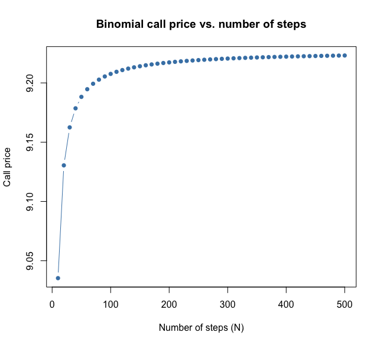

# Phase 2: Binomial Tree (CRR)

Prices options by splitting time into N small steps. At each step the
stock goes up or down. We start at expiry, where payoffs are known,
and work backward to today.

## Core idea

The one-step replication example, repeated at every node. At each node:

    V = exp(-r*dt) * (p * V_up + (1 - p) * V_down)

## Parameters (`crr_params()`)

    dt = T / N
    u  = exp(sigma * sqrt(dt))
    d  = 1 / u
    p  = (exp((r - q) * dt) - d) / (u - d)

- d = 1/u makes the tree recombine: up-then-down equals down-then-up.
  That gives N+1 endpoints instead of 2^N.
- p is the risk-neutral probability. It is not a forecast of the stock.
- The function stops if p is outside 0 to 1.

## Building blocks

- `terminal_prices()`: the N+1 possible stock prices at expiry,
  S * u^j * d^(N-j), where j is the number of up-moves.
- `terminal_values()`: applies `option_payoff()` from Phase 1 to them.
- `binomial_price_european()`: backward induction. Each pass shrinks
  the value vector by one until one value remains: today's price.
- `binomial_price()`: same walk, plus an `american` switch. When TRUE,
  each node takes the larger of hold value and exercise value.

## Results (S=K=100, r=5%, q=2%, sigma=20%, T=1, N=50)

| Option | Price |
|---|---|
| European call | 9.188225 |
| European put | 6.2913 |
| American put | 6.641549 |
| American call | 9.188225 |

**Checks passed**
- Put-call parity on the European prices: diff about -1.29e-13.
- With `american = FALSE`, the new function matches the European one.
- American put is higher than the European put, as expected.
- With q = 0, American and European calls are identical (10.41069).
- American put sits within the no-arbitrage bounds.

## Why early exercise helps a put but not a no-dividend call

- Put: the most it can pay is K. After a crash, waiting adds little,
  and cash in hand earns interest. So exercising early can pay.
- Call with no dividends: exercising early costs interest on K, gives up
  the safety net, and gains nothing. Waiting is always at least as good.
- With q = 2% the tree still found no early exercise for the call.

## Convergence

N from 10 to 500: price rises from 9.035 (N=10) and flattens near
9.223 (N=500).

Only even N were used, so no even/odd wobble shows. The true value
is checked against Black-Scholes in Phase 3.

## Limits

- Parity does not apply to American options.
- The tree gives an approximation. Accuracy improves with N.

## Mistakes caught along the way

- My first test for p never triggered the error (sigma = 3 was valid).
- I used d = 0.9 by hand; the code correctly used d = 1/1.1.
- I predicted a higher American call price. The code showed identical.