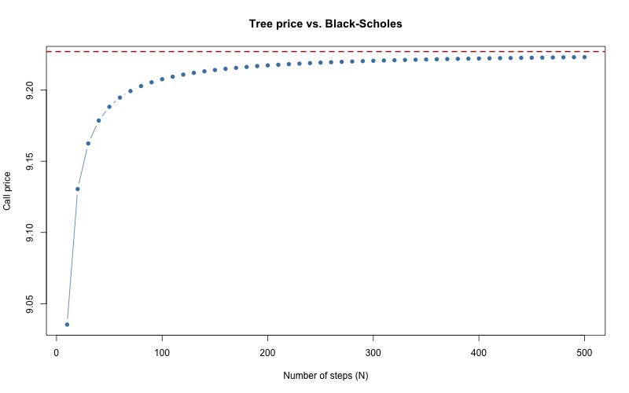

# Phase 3: Black-Scholes, the Greeks, and Implied Volatility

Black-Scholes gives the exact price of a European option. We use it
to check the tree from Phase 2, then add the Greeks and implied
volatility.

All examples use S = 100, K = 100, r = 5%, q = 2%, sigma = 20%, T = 1.

## The formula

    d1 = (ln(S/K) + (r - q + 0.5*sigma^2) * T) / (sigma * sqrt(T))
    d2 = d1 - sigma * sqrt(T)

    Call = S*exp(-qT)*N(d1) - K*exp(-rT)*N(d2)
    Put  = K*exp(-rT)*N(-d2) - S*exp(-qT)*N(-d1)

N is the standard normal CDF (`pnorm()` in R). With q = 0 this is the
formula from the Marchesi slides.

- d1 and d2 are scores: how far ahead the stock is, measured in
  "usual moves" (sigma * sqrt(T)).
- N(d2) is the chance of finishing in the money.
- Call = "what you get" minus "what you pay".

Functions: `bs_d()`, `bs_price()`. At T = 0 the price is the payoff.

## Results

| | Price |
|---|---|
| Call | 9.2270 |
| Put | 6.3301 |

**Checks passed**
- d1 = 0.25 and d2 = 0.05 match hand calculation.
- Put-call parity holds (diff about 1e-15).
- T = 0 returns the payoff.

## Tree vs. Black-Scholes

Two independent methods. The tree never uses d1 or d2, so agreement
is strong evidence both are right.

- N = 10: tree 9.035, error about -0.19
- N = 500: tree 9.223, error about -0.004

## The Greeks (for a newbie)

Each Greek answers one question: **what happens to my option if only
ONE thing changes?**

| Greek | Plain meaning | Example (call) | Sign |
|---|---|---|---|
| **Delta** | Option price change when the stock moves $1 | 0.5869: stock up $1, call up about $0.59 | Call +, put - |
| **Gamma** | How fast delta changes when the stock moves $1 | 0.0190: stock up $1, delta rises by 0.019 | Always + for a long option |
| **Vega** | Option price change when volatility moves 1 point | 0.3814: vol 20% to 21%, call up about $0.38 | Always + for a long option |
| **Theta** | Value lost per day from time passing | -0.0139: one day passes, call loses about $0.014 | Usually - for a long option |
| **Rho** | Option price change when the rate moves 1 point | 0.4945: rate 5% to 6%, call up about $0.49 | Call +, put - |

Put values: delta -0.3933, theta -0.0063, rho -0.4578. Gamma and vega
are the same for call and put.

**Units:** vega and rho are per 1 point (divided by 100). Theta is per
calendar day (divided by 365).

**Uses**
- Delta: the hedge ratio (shares held to offset the option).
- Gamma: how often the hedge needs adjusting.
- Vega: exposure to volatility changes.
- Theta: the daily cost of waiting.
- Rho: usually the smallest; matters least for simple trades.

**Long vs. short:** a short position flips every sign.

**Greeks are risk, not advice.** They describe the option. They don't
say whether to buy it. That depends on your view, price vs. fair
value, and break-even.

**How each was checked (the "bump" check):** each formula was compared
with a direct measurement. Nudge one input slightly, reprice with
`bs_price()`, and divide the price change by the nudge. The bump uses
different code from the formula, so agreement is real proof.

## Implied volatility

Run Black-Scholes backwards: given a market price, find the sigma that
produces it. No formula exists, so `uniroot()` searches between 0.0001
and 5.

- If the price is outside the no-arbitrage bounds (Phase 1), return `NA`.
- If the search fails, return `NA`.
- Round trip: price at sigma = 0.25, recover 0.25 (calls and puts).
- An impossible price (call at 150 on a 100 stock) returns `NA`.

This is how Phase 5 turns real market prices into a volatility number.

## Mini glossary

- **Premium:** the price paid for the option.
- **Strike (K):** the fixed price you can buy or sell at.
- **ITM / ATM / OTM:** paying now / at the strike / not paying now.
- **Deep:** far from the strike.
- **Long:** you bought the option. **Short:** you sold it.
- **Volatility:** how much the stock jumps around.

## Limits

- European options only. American options use the tree.
- Constant volatility. Real markets show a volatility smile (Phase 5).
- Greek values are close estimates for small moves.

## Mistakes caught along the way

- None in the code this phase. All tests matched predictions.