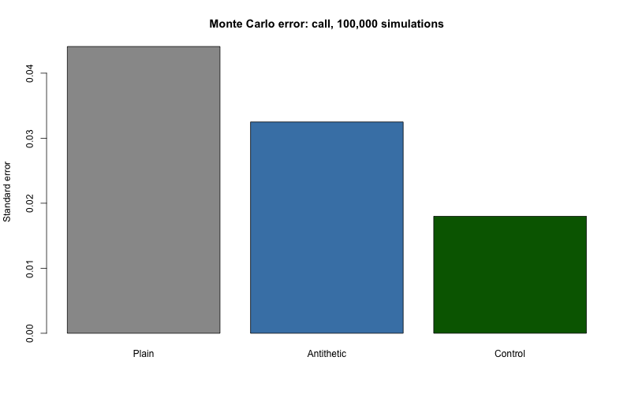
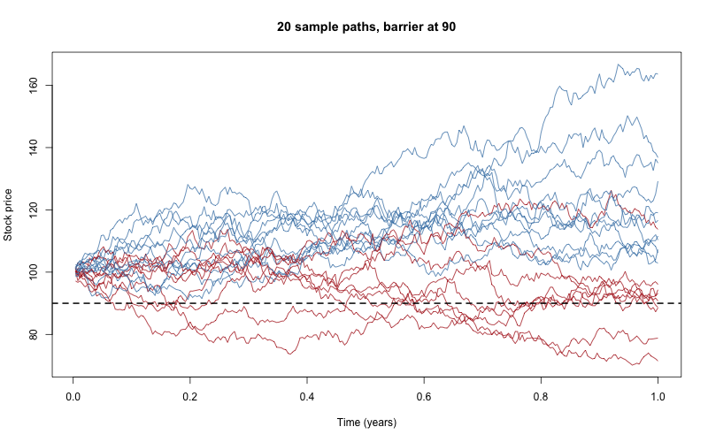

# Phase 4: Monte Carlo

Prices options by simulation: generate many possible stock prices,
compute the payoff on each, average, and discount. Error shrinks
with the square root of the number of simulations.

All examples use S = 100, K = 100, r = 5%, q = 2%, sigma = 20%, T = 1.

## Simulating the stock

Under the risk-neutral measure:

    S_T = S * exp((r - q - 0.5*sigma^2)*T + sigma*sqrt(T)*Z),  Z ~ N(0,1)

Function: `simulate_terminal()`. Seed: `set.seed(3130)`.

Checks (100,000 draws): average price 103.12 (target 103.05); log
return mean 0.0105 (target 0.01) and sd 0.2008 (target 0.2).

## Price with error

`mc_price()` returns the price, standard error (SE), and a 95%
interval (price +/- 1.96 SE).

| | Monte Carlo | Black-Scholes |
|---|---|---|
| Call | 9.299 (SE 0.0441) | 9.2270 |
| Put | 6.334 (SE 0.0290) | 6.3301 |

Both intervals contain the exact price.

**Coverage check:** 200 repeats of 10,000 simulations. The interval
caught the exact call price 196 times (98%). Target is about 95%, so
the SE is honest.

## Variance reduction

Same number of simulations, less noise.

**Antithetic variates** (`mc_price_anti()`): for each Z also use -Z.
The pair partly cancels noise. SE is computed from the pair averages,
not all draws (they are not independent).

**Control variates** (`mc_price_cv()`): use the discounted stock price,
whose exact mean is S*exp(-qT) = 98.02, to correct the payoff.
Adjusted payoff = Y - b*(X - E[X]), with b = cov(Y,X)/var(X).
b is a slope, not a correlation.

| Call, 100,000 sims | Price | SE | Coverage |
|---|---|---|---|
| Plain | 9.299 | 0.0441 | 98% |
| Antithetic | 9.241 | 0.0325 | 95.5% |
| Control variate | 9.2553 | 0.0180 | 95.0% |
| Exact | 9.2270 | | |

- Call b = +0.639 and put b = -0.361. They differ by exactly 1
  (put-call parity). Call and put SE are both 0.0180 for this reason.
- Control variates cut error by about 59%. Plain Monte Carlo would
  need about 6 times as many simulations to match.

## Path-dependent options

`simulate_paths()` builds n paths with m steps (a matrix, n rows by
m columns). Checks: shape 10000 x 50, first-step mean 100.10, final
mean 103.07 and sd 0.1997.

**Asian option** (`mc_asian()`): pays on the average price along the
path (50 monitoring points).

| | Price | SE |
|---|---|---|
| Asian call | 5.2835 | 0.0244 |
| Asian put | 3.7822 | 0.0177 |

Cheaper than regular options because averaging calms the price.
Check: with m = 1 it equals the plain call (9.299039, same seed).

**Down-and-out barrier call** (`mc_barrier()`, B = 90): dies if the
path touches the barrier.

Checking only 50 points misses dips between points, so the simulated
price is too high. Fix: shift the barrier toward the stock by
`B * exp(+0.5826 * sigma * sqrt(dt))` (about 91.5).

(Broadie, Glasserman and Kou shift the barrier away from the stock to price
a discrete option with the continuous formula; here we use the inverse, to
make a discrete simulation match the continuous formula. See sources.md.)

| Version | Price |
|---|---|
| No adjustment | 8.059 |
| Wrong sign (-) | 8.417 |
| Adjusted (+) | 7.593 |
| Exact formula (`bs_down_out_call()`) | 7.5870 |

The adjusted interval (7.508 to 7.677) contains the exact price.
With B = 1 the barrier call equals the plain call (9.2270 exact).

## Limits

- Results are random. Different seeds give slightly different numbers.
- Exact barrier formula needs B below both S and K, continuous monitoring.
- Asian average here is over 50 points, not continuous.
- SE values in the plot were typed from outputs, not recomputed.

## Mistakes caught along the way

- `m = 1` bug: R flattened the one-column matrix, collapsing all paths
  into one number. Fixed with `matrix(..., nrow = n)`.
- Barrier adjustment: I predicted and coded the wrong sign (barrier
  moved away from the stock). The exact formula exposed it.
- Several rough guesses of mine were off (SE ranges, Asian put range).

## Sources

- Stock simulation under the risk-neutral measure: Marchesi, "Black-Scholes
  From Scratch" (slides, Oct 2026), slide 32, with the dividend yield added.
- Antithetic and control variates: standard Monte Carlo methods written from
  memory. Checked by coverage tests (95% to 98%).
- Barrier shift 0.5826: Broadie, Glasserman and Kou (1997), Mathematical
  Finance 7(4), 325-349. The constant is also confirmed in Howison and
  Steinberg (2005). The full text of the 1997 paper was not read.
- Exact down-and-out call formula: standard continuous-barrier result typed
  from memory; no page checked. It agrees with the adjusted simulation
  (7.5870 vs. 7.593).
- Full list and status of every source: `docs/sources.md`.