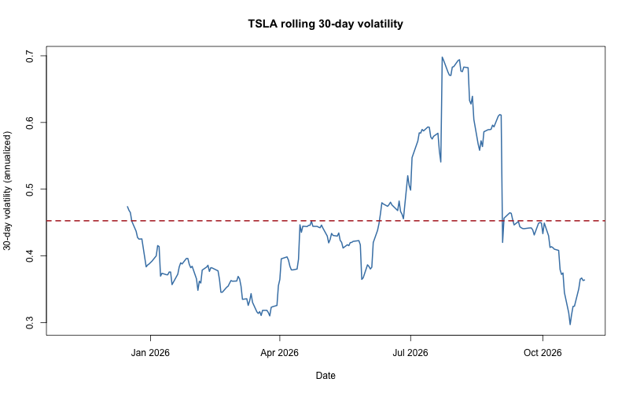
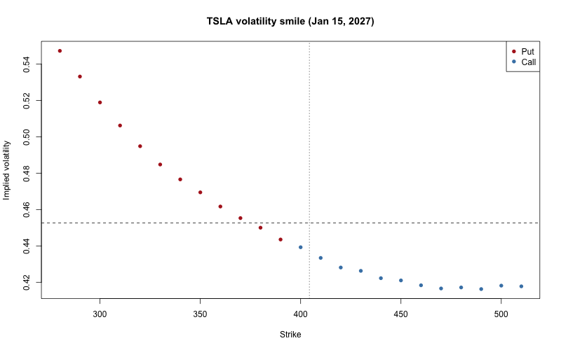
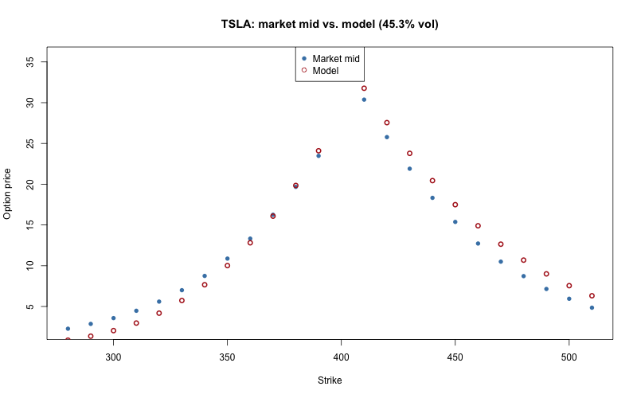

# Phase 5: Market Data, Historical and Implied Volatility

Tests our models against real data. We measure how much TSLA actually
moved (historical volatility), back out what the options market
expects (implied volatility), and compare.

Data: TSLA prices from Yahoo via `quantmod`, and the Jan 15, 2027
option chain pulled on 2026-11-02. Snapshot saved in `data/`.

## 5a: Historical volatility

Daily log return = ln(today / yesterday). Annualized volatility =
sd(daily returns) * sqrt(252).

- 249 daily returns (Nov 2025 to Oct 2026), using Adjusted prices.
- Daily volatility 0.0285; yearly 0.4526 (45.3%).

| Window | Volatility |
|---|---|
| Last 30 days | 36.4% |
| Last 90 days | 51.0% |
| Last 365 days (249 returns) | 45.3% |

Rolling 30-day volatility ranged from 29.7% to 69.8%. Volatility is
not constant, which Black-Scholes assumes.

## 5b: Option chain

`getOptionChain("TSLA", Exp = NULL)` returned all 22 expiries. We
used Jan 15, 2027 (124 calls, 124 puts). Raw rows included stale
last prices, zero bids and impossible quotes, so we cleaned them.

**Cleaning rules (248 rows became 24):**
- Bid > 0, Ask > 0, open interest > 0
- Strike between 70% and 130% of spot
- Out of the money only (puts below spot, calls above)
- Mid price = (Bid + Ask) / 2, and it must pass `check_bounds()`

Median bid-ask spread of the clean rows: $0.40.

Inputs: T = 74/365, q = 0 (TSLA pays no dividend), r = 4%
(placeholder, not a real yield).

## The spot price problem

The downloaded close (Oct 30, $399.81) did not match the spot the
option quotes used. Put-call parity at strike 400 gives an implied
spot of **$404.37**.

Using the stale spot, the center of the smile jumped (390 put 41.8%
vs. 400 call 47.6%). With the implied spot the gap fell to 0.4 points
(44.4% vs. 43.9%).

## Implied volatility and the smile

`bs_implied_vol()` run on each mid price, with the implied spot.
Result: about 55% at strike 280 (put) falling to about 42% at strike
510 (call). The curve slopes down to the right: the market charges
more for crash protection.

## Implied vs. historical

| Measure | Volatility |
|---|---|
| Implied (390 put and 400 call average) | 44.1% |
| Historical, 30 days | 36.4% |
| Historical, 90 days | 51.0% |
| Historical, 365 days | 45.3% |

Implied is above the 30-day number, below the 90-day number, and
close to the 1-year number. "Rich or cheap" depends on the window.
This is a comparison, not advice.

## Model price vs. market price

Black-Scholes at 45.3% volatility for every strike.

- Puts: market above model at low strikes (+1.4 to +1.5 at strikes
  280 to 310). Average gap +0.87.
- Calls: market below model (about -1 to -2.2). Average gap -1.79.
- Near the stock price, the gap is close to zero for puts.

A single volatility cannot match a market that shows a smile.

## Limits

- r = 4% is a placeholder.
- Spot of 404.37 is backed out from one strike.
- TSLA options are American; Black-Scholes is European. The effect
  was not measured.
- One expiry, one day.
- Historical volatility looks backward.
- Dollar gaps are per share; a contract is 100 shares.

## Mistakes caught along the way

- `Exp = NULL` returned all expiries, not the nearest one.
- The first rolling-volatility plot had no visible red line.
  `abline()` did not draw on the time-series plot.
- Rolling windows returned 249 values (29 `NA`), not 220.
- My first spot assumption was stale. Parity exposed it.
- Several rough guesses were off (call gap size, plot shape).

## Sources

- Prices and option chain: Yahoo Finance, pulled through the `quantmod` R
  package. TSLA prices to 2026-10-30; the chain was pulled on 2026-11-02 and
  saved in `data/`. Yahoo data can lag by a day.
- Volatility: daily log returns, annualized by sqrt(252) (a standard
  convention).
- Implied spot from put-call parity: the Phase 1 relationship, applied to
  one strike.
- Interest rate: 4% is a placeholder, not a market value.
- Full list and status of every source: `docs/sources.md`.