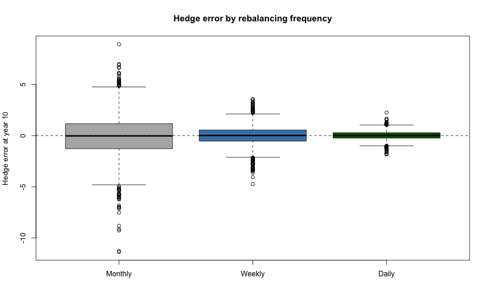
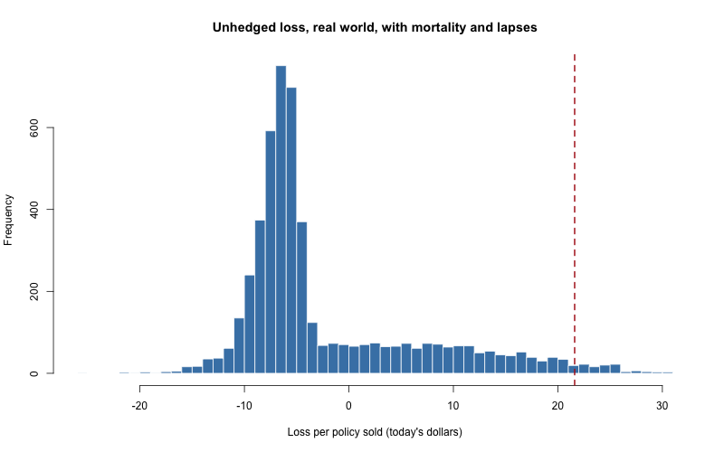

# Phase 6: Segregated Fund Maturity Guarantee

Applies the earlier phases to an insurance product. A segregated fund
guarantees the policyholder at least G at maturity. That promise is a
put option the insurer has sold. We price it, add mortality and
lapses, solve for the fair fee, test a delta hedge, and compute a
tail reserve (CTE).

Two probability measures are used and labelled in the code:
- **Pricing** (risk-neutral): the market grows at r.
- **Hedging and reserves** (real world): the market grows at mu.

## The product (all values are assumptions, adjustable in `seg`)

| Item | Value |
|---|---|
| Premium P0 | 100 |
| Guarantee G | 100 (100% of premium) |
| Term T | 10 years |
| Fee (MER) | 2.5% a year |
| Volatility sigma | 20% (placeholder) |
| Rate r | 3.8% (see Sources) |
| Issue age | 50 |
| Lapse rate | 5% a year |
| Real-world return mu | 7% (assumption, hedging and reserves only) |
| Hedge frequency | 52 a year |
| Paths | 5000, seed 3130 |
| CTE level | 95% |

At maturity the policyholder gets the larger of the fund and G. The
insurer pays max(G - F_T, 0), a put payoff.

## Pricing the guarantee

The fee leaves the fund continuously, like a dividend. So the put is
priced with `bs_price()` using q = fee.

| Case | Cost per 100 invested |
|---|---|
| r = 4% (placeholder) | 13.04 |
| r = 3.8% | 13.77 |
| r = 3.8%, with mortality and lapses | 8.08 |

Checks: sigma near 0 gives about 0; higher sigma or higher G costs
more.

## Mortality and lapses

Survival uses Gompertz-Makeham: t_p_x = exp[-A t - B C^x (C^t - 1) /
ln C], with A = 0.00022, B = 0.0000027, C = 1.124. Persistency is
(1 - lapse)^t. Probability still in force at year 10 (age 50):
0.9803 x 0.5987 = 0.5869. The guarantee cost is multiplied by this.

Assumption: mortality and lapses are independent of each other and of
the market. Lapses removed far more policies than deaths.

## Monte Carlo check

Simulated fund at year 10: F_T = P0 x (market growth) x exp(-fee T),
with the market growing at r.

- Simulation 13.050 (SE 0.051) vs. formula 13.043. Interval contains
  the formula price.
- With decrements: 7.652 vs. 7.656.
- Coverage over 200 repeats: 96%.

This confirms that "fee acts as a dividend yield" is correct.

## Sensitivity to rate and volatility

Cost per 100 (no decrements):

| | vol 15% | vol 20% | vol 25% | vol 30% |
|---|---|---|---|---|
| r 2% | 17.05 | 21.88 | 26.59 | 31.17 |
| r 3% | 12.42 | 17.01 | 21.50 | 25.85 |
| r 4% | 8.82 | 13.04 | 17.22 | 21.31 |
| r 5% | 6.09 | 9.85 | 13.67 | 17.45 |
| r 6% | 4.09 | 7.32 | 10.75 | 14.20 |

A 1-point change in rate moves the price by about 3 to 4, roughly
25 to 30%. Over 10 years, rate and volatility both matter a lot.

## Fair fee

The fee appears on both sides: more income, but a costlier
guarantee. So `uniroot()` searches for the fee where PV of fee income
equals the guarantee cost (with decrements).

- At a 2.5% fee: income 17.37, cost 8.08.
- **Fair fee: 0.788% a year.** Income 5.9066 vs. cost 5.9071.

Assumption: the whole fee pays for the guarantee. In reality part pays
for expenses and commissions. The solver stops at a tolerance, so the
gap is not exactly 0 (-0.0006).

## Delta hedging (real world, no mortality or lapses)

The insurer is short the put. Each period it holds delta units of the
fund (a short position) plus a cash account, starting from the put
price. Hedge error = hedge value minus the shortfall owed at year 10.

| Hedges a year | Mean error | SD of error |
|---|---|---|
| 12 | -0.06 | 2.05 |
| 52 | -0.03 | 0.96 |
| 252 | 0.01 | 0.43 |

- Unhedged SD of the payout: 18.31. Weekly hedging: 0.98 (about 95%
  less).
- The SD falls roughly with the square root of the number of
  rebalances.
- No transaction costs.

Note: this plot comes from `hedge_error()`, which has no mortality or
lapses.

## Hedging with mortality and lapses

Under the large-pool assumption every piece of the hedge scales by
the in-force fraction 0.5869. `hedge_error_dec()` was written to
check this independently. The two methods agree to 5e-13.
Result: error SD 0.577 vs. unhedged payout SD 10.75.

Limit of the check: the weights are the same at every week, so
agreement tests the code and the survival maths, not the large-pool
assumption.

## CTE reserve (real world, unhedged)

Loss per path = PV of guarantee payout minus PV of guarantee fee income
(fair fee 0.788%, collected weekly while the fund exists).
CTE95 = average of the worst 5% of losses.

| Case | Mean loss | CTE95 |
|---|---|---|
| No decrements | -1.11 | 38.56 |
| With decrements (per policy sold) | -2.18 | 21.61 |

95th percentile of the no-decrement loss: 31.28.

The reserve is a different question from the price: the price is the
fair value of the promise, the reserve is capital for bad markets.

Sensitivity (no decrements):

| mu | Mean loss | CTE95 |
|---|---|---|
| 4% | 5.93 | 45.63 |
| 7% | -1.11 | 38.56 |
| 9% | -4.76 | 32.57 |

| sigma | Mean loss | CTE95 |
|---|---|---|
| 15% | -0.76 | 28.07 |
| 20% | -1.11 | 38.56 |
| 25% | -1.46 | 45.77 |

The fair fee was recomputed for each sigma.

## Assumptions (not facts)

- sigma 20% constant; rate 3.8%; mu 7%; lapse 5%; issue age 50.
- Lapses independent of the market (real lapses tend to be higher
  when the guarantee is worthless; this likely understates the cost
  and the reserve).
- Large pool: the in-force fraction equals its expected value, so
  random variation in deaths and lapses is ignored.
- Income is the guarantee charge only.
- No transaction costs, no expenses, no commissions.
- Fee "dividend" in the hedge is approximated weekly.
- Mortality is the same for everyone (no smoker or sex split).

## Limits

- Constant volatility. A 10-year put in a real market would likely
  carry higher implied volatility (the smile in Phase 5), so the cost
  may be understated. Not measured.
- CTE95 uses the worst 250 of 5000 paths, so it is noisy by perhaps a
  point or two. Not measured.
- Results depend heavily on mu and r, as the sensitivity tables show.

## Sources

See `docs/sources.md`.
- Gompertz-Makeham parameters: ACT 3130 course notes.
- Rate: Canada 10-year government bond yield, about 3.8% (3.79% on
  2026-10-15), from a Trading Economics summary of Bank of Canada
  data. Not today's close and not the official series.
- Black-Scholes and the put formula: Phase 3, Marchesi slides.
- CTE and the seg fund framework: the idea of a tail-based reserve is
  standard in Canadian seg fund capital rules. I have not checked
  the exact regulatory formula, so this project's reserve is an
  illustration, not a regulatory calculation.

## Mistakes and corrections along the way

- My first Step 10 description of the hedge weight was wrong. It
  described a per-in-force-policy weight, but we measure per policy
  sold.
- Step 10's first two tests only confirmed a multiplication by 0.587.
  They did not test the hedge. `hedge_error_dec()` was added to check.