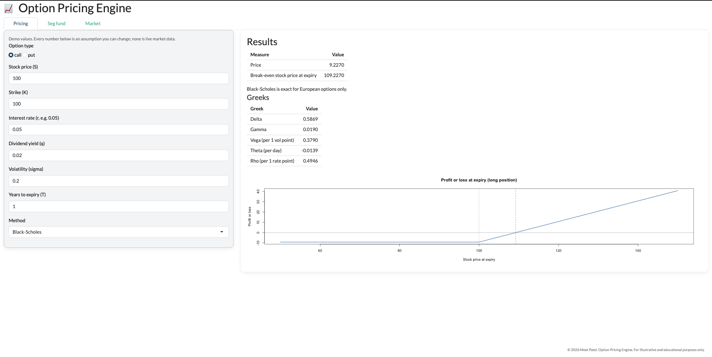
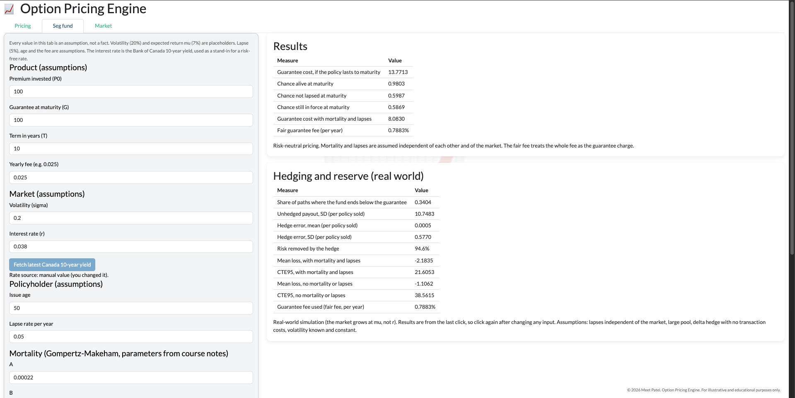
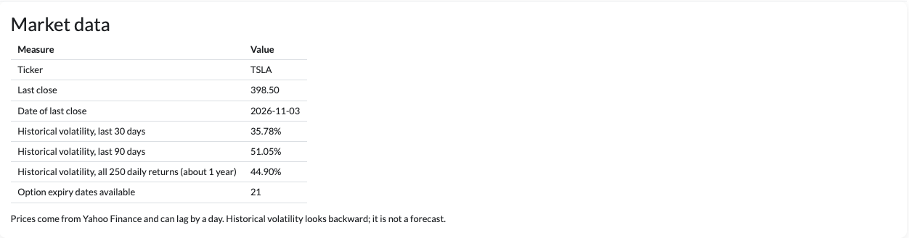
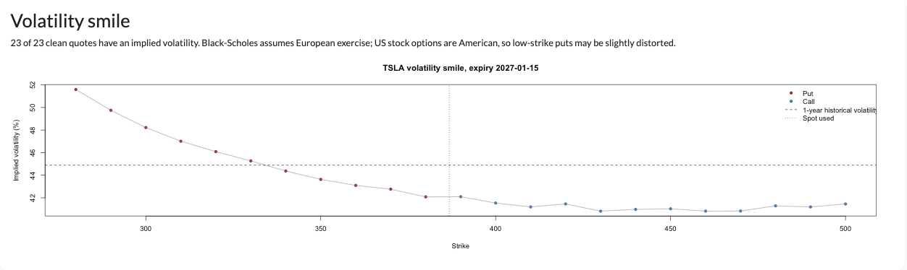
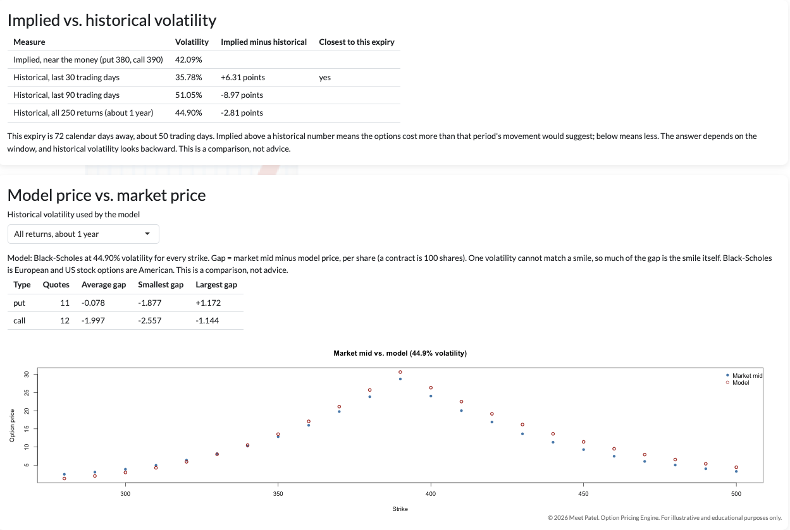

# Phase 7: The App

Packages the models into a Shiny app with three tabs, built on one
functions-only file, `r/engine.R`. The Quarto report, README and interview
guide come after this phase.

## How to run it

1. Open `app/app.R` in RStudio and click **Run App**.
2. Packages needed: `shiny`, `bslib`, `jsonlite`, `quantmod`.
3. The Market tab and the live rate need internet.

The app loads `r/engine.R` (with a path fallback, because Run App changes the
working folder to `app/`).

## The engine file (`r/engine.R`)

Functions only: no plots, and no loops that run on load, so the app starts
fast. It contains the payoff, parity and bounds checks (Phase 1), the
binomial tree (Phase 2), Black-Scholes, the Greeks and implied volatility
(Phase 3), the three Monte Carlo pricers (Phase 4), and the seg fund pricing,
fair fee, hedging and CTE functions (Phase 6). It also has new functions for
the live Canada yield, the market data loader, chain cleaning, the implied
spot, implied volatility per quote and the comparisons.

Not copied into the engine: the Asian and barrier options, and the
sensitivity code. The app does not use them.

Every function was checked by reproducing the numbers from the phase where it
was first built (for example, Black-Scholes call 9.227006, American put
6.641549, seg fund cost 13.77135, hedge error SD 0.5770096).

## Tab 1: Pricing

Inputs: option type, S, K, r, q, sigma, T, and a method (Black-Scholes,
binomial tree, Monte Carlo). The tree has N and an American box. Monte Carlo
has a variance reduction choice, n and a seed.

Outputs: the price, the break-even stock price at expiry (strike plus price
for a call, strike minus price for a put; it ignores interest on the premium),
the five Greeks (Black-Scholes only, because the formulas are for European
options) and a profit-or-loss plot at expiry.

Defaults reproduce the earlier phases: call 9.2270, put 6.3301, tree 9.1882
(N = 50), Monte Carlo 9.2990 (plain, seed 3130). The default call Greeks are
delta 0.5869, gamma 0.0190, vega 0.3790, theta -0.0139 and rho 0.4946.

**Guards**
- Tree steps are capped at 5,000. Timed in the Console: 0.017 s at N = 500,
  0.038 s at 1,000, 0.093 s at 2,000, 0.377 s at 5,000. Typing 500,000 froze
  R until it ended. I did not time anything above 5,000.
- Monte Carlo needs at least 1,000 simulations, an even number.
- Bad inputs show one message instead of crashing.

## Tab 2: Seg fund

Every assumption is an input box, including the mortality parameters. One card
shows the pricing (Phase 6, Steps 1 to 7): the guarantee cost, the chance of
being alive, not lapsed and in force at maturity, the cost with mortality and
lapses, and the fair guarantee fee. A second card shows the hedging and
reserve results (Steps 8 to 10), which run on a button because they need
thousands of simulated paths. Paths x term x hedges per year must be 6,000,000
or less. I chose that cap by judgement and did not time it.

With the interest rate typed as 0.038, the card gives the Phase 6 numbers:
cost 13.7713 (the Console prints 13.77135, so the fourth decimal is a rounding
edge), with mortality and lapses 8.0830, fair fee 0.7883%. The hedging card
gave: fund ends below the guarantee in 0.3404 of paths, unhedged payout SD
10.7483, hedge error mean 0.0005 and SD 0.5770 (94.6% of the risk removed),
CTE95 21.6053 with mortality and lapses and 38.5615 without.

**Live rate.** On start the app fetches the latest Government of Canada
10-year yield from the Bank of Canada (Valet API) and fills the rate box. When
tested it returned 3.74% for 2026-11-02. A button refetches it. The user can
type any rate, and a line says whether the rate is live, manual or the saved
fallback (3.8%, dated 2026-10-15, used if the download fails). The fallback
path was tested with a bad series name; the Wi-Fi-off test was not run.

The 10-year yield is a stand-in for a risk-free rate, which is an assumption.

## Tab 3: Market

1. **Load.** The user types a ticker. Prices come from Yahoo through
   `quantmod`, with a friendly message for a bad symbol. The card shows the
   last close and the 30-day, 90-day and 1-year historical volatility.
2. **Chain.** The expiry dropdown picks an option chain. The cleaning rules
   from Phase 5 run on it (bid and ask above 0, open interest above 0, strike
   inside a window, out of the money only, passes the no-arbitrage bounds),
   with a count after each rule. Inputs: rate (typed, default 4%, a
   placeholder), dividend yield (default 0) and the strike window (70% to
   130%).
3. **Implied spot.** The last close can be stale, so the app can instead use
   the spot implied by put-call parity: the median over the 5 strikes nearest
   the close. For the Phase 5 snapshot the median was 404.1558; a single
   strike (400) gave 404.3693, the Phase 5 figure.
4. **Smile.** Implied volatility at each cleaned strike, puts and calls on one
   curve.
5. **Implied vs. historical.** The near-the-money implied volatility next to
   the three historical numbers, and the difference in points.
6. **Model vs. market.** Black-Scholes at a chosen historical volatility for
   every strike, against the market mid price.

**Results seen, session 1 (2026-11-03 evening, TSLA last close 403.82 on 2026-11-02)**

| Expiry | Days | Implied, near the money | Historical 30 / 90 / 1-year |
|---|---|---|---|
| 2026-12-04 | 31 | 44.57% | 35.57% / 51.04% / 45.18% |
| 2027-01-15 | 73 | 43.29% | 35.57% / 51.04% / 45.18% |

Model vs. market at the 1-year volatility (45.18%), average gap (market mid
minus model, per share):

| Expiry | Puts | Calls |
|---|---|---|
| 2026-12-04 | +0.804 | -0.580 |
| 2027-01-15 | +0.449 | -1.874 |

**Results seen, session 2 (2026-11-04 morning; the screenshots)**

Last close 398.50 on 2026-11-03; historical volatility 35.78% (30 days),
51.05% (90 days), 44.90% (1 year). Expiry 2027-01-15, 72 days (about 50
trading days), 23 of 23 clean quotes with an implied volatility.

| Measure | Value |
|---|---|
| Implied, near the money (put 380, call 390) | 42.09% |
| Implied minus 30-day / 90-day / 1-year | +6.31 / -8.97 / -2.81 points |
| Model at 44.90%, puts (11 quotes): average gap | -0.078 (range -1.877 to +1.172) |
| Model at 44.90%, calls (12 quotes): average gap | -1.997 (range -2.557 to -1.144) |

The smile slopes down to the right, from about 52% at strike 280 to about 41%
at the highest strikes. The dotted line marks the spot used for this chain,
about 387 as read from the plot, well below the last close of 398.50. The
likely reason (not checked) is that the options were quoted at an intraday
price the Yahoo close cannot show, which is the case the option-implied spot
is meant to handle. The put gap moved from +0.449 in session 1 to -0.078 in
session 2, which fits a different spot and a different day, but I did not
isolate the cause.

The model volatility dropdown moved the gaps in the expected order (30-day
largest, 90-day smallest). Implied volatility is above the 30-day number,
below the 90-day number and close to the 1-year number, so "rich or cheap"
depends on the window. This is a comparison, not advice.

## Known inconsistencies

The app code was copied into `r/engine.R` and the phase scripts were left
unchanged, so that the documented results stay reproducible. As a result:

1. **Duplicated functions.** A change to one copy does not reach the other.
2. **Mortality parameters.** The Phase 6 script reads a global `gm`; the
   engine keeps them inside the assumptions list (`a$gm`).
3. **Default rate.** The Phase 6 script starts at 0.04 and is then set to
   0.038; the engine starts at 0.038, and the app replaces it with the live
   yield.
4. **Guarantee fee.** The Phase 6 script sets `guar_fee` by hand; the engine
   uses the fair fee unless one is supplied.
5. **Monte Carlo helper.** The engine's pricers share `mc_summary()`; the Phase
   4 script computes the price, SE and interval inline. Results are identical.
6. **Volatility functions.** `hist_vol()` and `vol_window()` exist in both
   places.
7. **Snapshots.** The Phase 5 script overwrites the TSLA snapshot every time it
   runs and hardcodes the date. `save_chain_snapshot()` in the engine never
   overwrites and takes the date from the clock, but it is not connected to the
   app, so the app does not save snapshots yet.
8. **Defaults differ between tabs.** The Pricing tab uses demo values (r 5%,
   q 2%); the Market tab uses a 4% placeholder rate and q = 0.

## Assumptions (not facts)

- Seg fund: volatility 20%, expected return 7%, lapse 5%, age 50, fee 2.5%.
  The guarantee charge is the fair fee, and the whole fee is treated as the
  guarantee charge.
- Market tab: the rate is typed in (4% default), the dividend yield is typed in.
- Mortality and lapses are independent of each other and of the market. The
  large-pool assumption ignores random variation in deaths and lapses.

## Limits

- Black-Scholes is European; US stock options are American. Low-strike puts may
  carry early-exercise value the model ignores. The size of this was not
  measured.
- Yahoo data can lag by a day. Its price history ended on 2026-11-02 when
  checked on the evening of 2026-11-03, and on 2026-11-03 on the morning of
  2026-11-04.
- The implied spot depends on the typed rate and dividend yield, and on
  American-put early-exercise value, which parity ignores. The effect of each
  was not measured.
- The hedging and reserve results are stale after you change an input, until
  you click the button again.
- The 10-year yield is not a risk-free rate for options.
- One volatility cannot match a smile, so much of the model-vs-market gap is
  the smile itself.
- The legend text on two plots runs past the right edge of the plot area.
- Not tested: a stock with prices but no listed options, a thinly traded
  chain, WMT or any ticker other than TSLA, and the live rate with no
  internet.

## Mistakes caught along the way

- I told you to click Source on the Phase 5 script. It re-pulled TSLA and
  overwrote the snapshot and plots; you reverted them.
- The first loading box covered the footer; it was moved with CSS.
- The error message showed twice, because two outputs read the same failing
  calculation. My test only checked that the app did not crash.
- My N-squared estimate for the tree was too pessimistic (timings showed about
  2.2 to 2.4 times per doubling), and my guess that the wait came from
  keystrokes was wrong. The cause was a huge N.
- A stray double comma, then a missing bracket (the Market tab was nested
  inside Seg fund), then a duplicated radio button. My indentation-based
  instructions did not match your re-indented file.
- The server code crashed when the spot-source radio was missing. It now
  falls back to the implied spot.
- The expiry dropdown did nothing until the chain piece existed, and I did
  not say so.
- My first bad-ticker test was too long to reach Yahoo, so it tested the
  symbol check only.
- I predicted 10 columns in a snapshot test; the answer was 8.
- In Phase 5 I called the 90-day window the "closest match" for a 74-day
  option. That compared calendar days with trading days.
- In Phase 3 I gave wrong expected values for vega (0.3814, correct 0.3790),
  call rho (0.4945, correct 0.4946) and put rho (-0.4578, correct -0.4566).
  The code was right. I only saw the app's screenshot later, so for those
  tests "they match" had not been checked against the digits.

## Sources

- Bank of Canada Valet API, series BD.CDN.10YR.DQ.YLD (rate and date as
  returned on 2026-11-03).
- Yahoo Finance through `quantmod` (prices and option chains).
- Barrier constant and formulas: see `docs/sources.md` and Phase 4.
- Full list and status of every source: `docs/sources.md`.