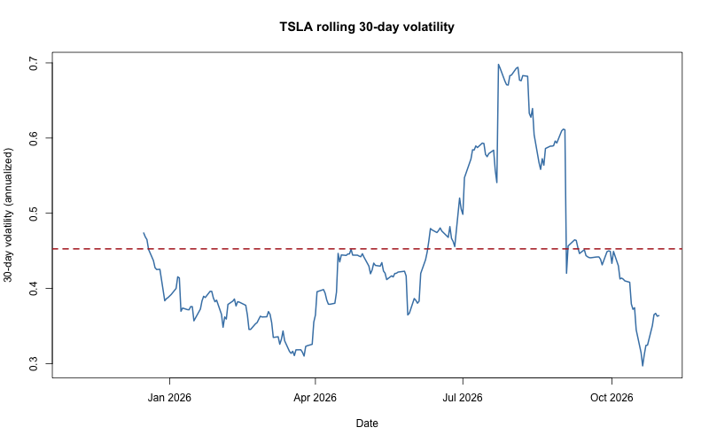
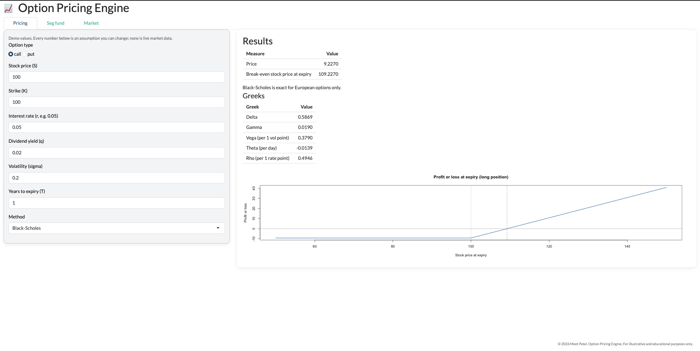
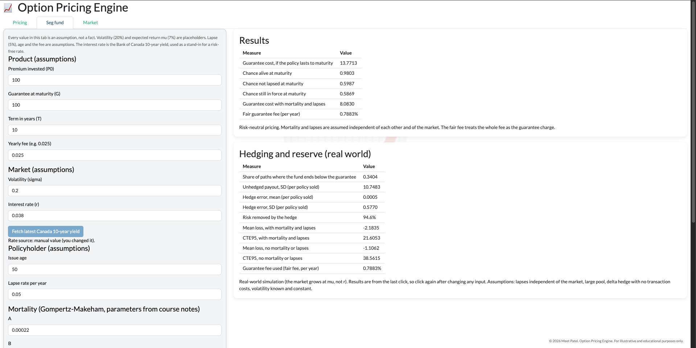
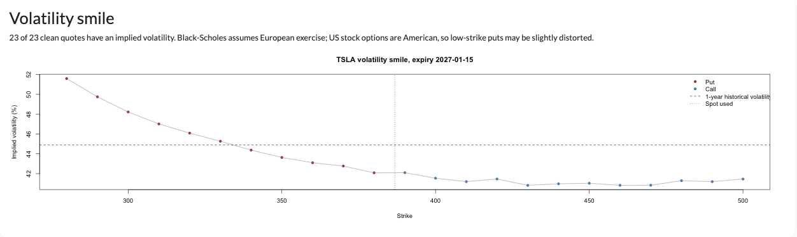
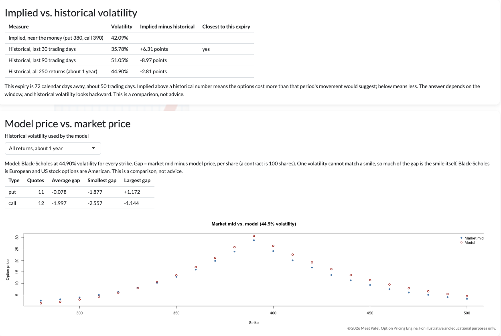

```{r}
#| label: setup
#| include: false
source("../r/engine.R")
set.seed(3130)
```

# Summary {.unnumbered}

This project prices options three independent ways, checks the methods
against each other, tests them on real Tesla option data, and applies them to
an insurance problem: the minimum-return guarantee on a segregated fund, which
is a put option the insurer has sold. It ends in a three-tab app.

```{r}
#| label: summary-numbers
#| echo: false
tree500 <- binomial_price(100, 100, 0.05, 0.02, 0.2, 1, 500, "call")
sa <- seg_defaults()
knitr::kable(data.frame(
  Result = c("European call, Black-Scholes (stock 100, strike 100, rate 5%, dividend yield 2%, volatility 20%, 1 year)",
             "The same call, binomial tree with 500 steps",
             "The same call, Monte Carlo with a control variate, 100,000 simulations",
             "Seg fund guarantee, cost per 100 invested, if the policy lasts 10 years",
             "The same, allowing for mortality and lapses",
             "Fair yearly fee for the guarantee alone",
             "Weekly delta hedge: share of the insurer's risk removed",
             "Reserve (CTE95) per 100 sold, without and with mortality and lapses",
             "Tesla implied volatility, January 2027 expiry, on 2026-11-02"),
  Value = c(sprintf("%.4f", bs_price(100, 100, 0.05, 0.02, 0.2, 1, "call")),
            sprintf("%.4f", tree500),
            "9.2553 (standard error 0.018)",
            sprintf("%.2f", guarantee_cost(sa)),
            sprintf("%.2f", guarantee_cost_dec(sa)),
            sprintf("%.2f%%", 100 * fair_fee(sa)),
            "about 95% (error SD 0.98 against 18.3 unhedged)",
            "38.6 and 21.6",
            "about 55% at the lowest strike, falling to about 42% at the highest"),
  Chapter = c("4", "3", "5", "7", "7", "7", "7", "7", "6")),
  col.names = c("Result", "Value", "Chapter"))
```

The first two lines of the table come from code that runs when this report is
built. The others are from the chapters named, where the code is shown.

**What the checks showed.** The tree, the formula and the simulation agree to
a few cents. Put-call parity holds to rounding error on every method. Every
Greek was compared with a direct nudge calculation. In the seg fund chapter,
the formula and a simulation gave the same price, and the hedge removed most of
the risk.

**What to be careful about.** Most inputs in the seg fund chapter are
assumptions, not data: the 20% volatility, the 7% expected return, the 5% lapse
rate, and the independence of lapses from the market. The results move a lot
with the interest rate and the volatility. Black-Scholes is a European-option
formula and Tesla's options are American. And real options show a volatility
**smile**, which a single volatility cannot match. Chapter 9 gathers all of
these, and Chapter 10 lists the mistakes found along the way.

# Options from scratch

::: {.callout-tip title="In plain words"}
An option is a contract that gives you the **right, but not the duty**, to buy
or sell something at a fixed price. Because you only use it when it helps you,
it can never leave you worse off than the price you paid for it. That
one-sidedness is why options have a price, and why volatility makes them worth
more.
:::

## What an option is

An option lets you trade a stock at a fixed price, the **strike** (K), until a
fixed date, the **expiry** (T). You pay a price for that right today. That
price is the **premium**, and working out what it should be is what "option
pricing" means.

| | Call | Put |
|---|---|---|
| Right to... | **Buy** at the strike | **Sell** at the strike |
| You want the stock to... | Go up | Go down |
| Pays off when the stock ends | Above the strike | Below the strike |

A put works like insurance. If I own a stock and also own a put, I can sell
the stock for at least the strike, however far it falls. I use this idea again
in the seg fund chapter.

## Payoffs

At expiry, a call pays the larger of (stock price minus strike) and zero. A
put pays the larger of (strike minus stock price) and zero. I only exercise
when it helps, so the payoff is never negative.

```{r}
#| label: fig-payoffs
#| fig-cap: "Payoff at expiry of a call and a put, both with strike 100."
#| fig-height: 3.5
S_T <- seq(50, 150, by = 1)
par(mfrow = c(1, 2), mar = c(4, 4, 3, 1))
plot(S_T, option_payoff(S_T, 100, "call"), type = "l", lwd = 2,
     col = "steelblue", xlab = "Stock price at expiry", ylab = "Payoff",
     main = "Call, strike 100")
abline(v = 100, lty = 2, col = "grey60")
plot(S_T, option_payoff(S_T, 100, "put"), type = "l", lwd = 2,
     col = "firebrick", xlab = "Stock price at expiry", ylab = "Payoff",
     main = "Put, strike 100")
abline(v = 100, lty = 2, col = "grey60")
```

The flat part of each line is the "right, not duty": below the strike a call
pays nothing, and I simply do not use it. The loss is capped at the premium,
and the gain is not. More movement in the stock can only help me, which is why
**higher volatility raises the price of both calls and puts**.

## Long and short

- **Long** means I bought the option. I paid the premium and hold the right.
- **Short** means I sold (wrote) it. I collected the premium and took on the
  obligation.

Every sensitivity of a short position is the opposite of the long one. In the
seg fund chapter, the insurer is **short** a put.

## In, at and out of the money

| Term | Call | Put |
|---|---|---|
| In the money | Stock **above** strike | Stock **below** strike |
| At the money | Stock **equal** to strike | Stock **equal** to strike |
| Out of the money | Stock **below** strike | Stock **above** strike |

"In the money" means exercising now would pay something, for both calls and
puts. "Deep" means far from the strike. An option that already pays costs
more. An option that does not pay yet costs less and needs a bigger move.

## Pricing by replication: a one-step example

The idea that everything else rests on is **replication**. I can build a
portfolio of the stock and borrowed cash that pays exactly what the option
pays, in every outcome. The option must then cost what that portfolio costs,
or someone could make a riskless profit (an **arbitrage**).

Take a stock at 100 that will be either 120 or 90 next year, and a call with
strike 100. For simplicity the interest rate is zero.

```{r}
#| label: one-step
S0 <- 100; up <- 120; down <- 90; K <- 100
pay_up   <- max(up - K, 0)                 # call pays 20 if the stock rises
pay_down <- max(down - K, 0)               # and 0 if it falls
shares   <- (pay_up - pay_down) / (up - down)
borrow   <- shares * down - pay_down       # cash to borrow
price    <- shares * S0 - borrow           # what the replicating portfolio costs
p_up     <- (S0 - down) / (up - down)      # risk-neutral probability of "up"
price_rn <- p_up * pay_up + (1 - p_up) * pay_down
round(c(shares = shares, borrow = borrow, price = price,
        p_up = p_up, price_via_p = price_rn), 4)
```

Holding two thirds of a share and borrowing 60 pays 20 if the stock rises and
0 if it falls, the same as the call. So the call costs
`r round(price, 2)`. The shortcut with the "risk-neutral probability" (the
probability that makes the stock's expected future price equal today's price)
gives the same number.

## Why the price does not depend on direction

The probability that the stock goes up never entered the replication. The
portfolio matches the option whether "up" has a 10% chance or a 90% chance.
That is why a pricing model can quote a call and a put without any opinion on
where a stock is heading. It prices the **cost of the exposure**, not a
forecast.

The same idea, repeated over many small steps, is the binomial tree in the
next chapters, and its limit is the Black-Scholes formula.

# Phase 1: Foundations

::: {.callout-tip title="In plain words"}
Before building any pricing model, I wrote down the rules that **any**
correct option price must obey. They do not depend on a model, so they can
catch mistakes in all the later ones. The main rule is **put-call parity**: a
call and a put with the same strike are tied together by interest rates and
the stock price, with no role for volatility or for anyone's view on direction.
:::

## The payoff function

The function `option_payoff()` returns what a call or a put pays at expiry. It
uses `pmax()` rather than `max()`, so it works on a whole vector of stock
prices at once. Later phases need that for the tree's end points and for
thousands of simulated prices.

```{r}
#| label: payoff-check
option_payoff(c(80, 90, 100, 110, 120), 100, "call")
option_payoff(c(80, 90, 100, 110, 120), 100, "put")
```

## Combining payoffs

Any position is a sum of basic payoffs, with a minus sign on anything sold.
A **straddle** (a long call and a long put at the same strike) pays more the
further the stock moves in **either** direction, and nothing if it stays put.
It is a bet on movement with no view on direction. That is the clearest
example of why a pricing model can quote a price without forecasting.

```{r}
#| label: fig-straddle
#| fig-cap: "Payoff of a straddle: long call plus long put, strike 100."
#| fig-height: 3.5
straddle <- option_payoff(S_T, 100, "call") + option_payoff(S_T, 100, "put")
plot(S_T, straddle, type = "l", lwd = 2, col = "purple",
     xlab = "Stock price at expiry", ylab = "Payoff")
abline(h = 0, col = "grey60")
```

A bull call spread (long a call at 95, short a call at 110) works the same
way: the short leg is subtracted, and the payoff is capped at the gap between
the strikes. Neither position is used by a later phase. They show that one
correct payoff function covers any structure, and the seg fund guarantee
later turns out to be a put in disguise.

## Put-call parity

For European options on the same stock with the same strike and expiry,

$$C - P = S\,e^{-qT} - K\,e^{-rT}$$

where C and P are today's call and put prices, S is the stock price, K the
strike, T the years to expiry, r the interest rate and q the dividend yield.
This does **not** say a call and a put cost the same. It says the **gap**
between them is fixed by S, K, r, q and T.

::: {.callout-note title="Why it holds: two ways to end up with one share"}
**Way 1.** Buy a call and sell a put, both at strike K. Whichever one ends up
in the money, I am made to buy the stock at K: I use my call if the stock is
high, and the buyer of my put uses it against me if the stock is low. Either
way, in a year I own one share and I paid K for it.

**Way 2.** Borrow today exactly the amount that grows into K in a year. Use it
to buy a little less than one share, and reinvest the dividends, so the
holding grows to exactly one share. In a year I own one share and owe K.

Both ways give the same result whatever the stock does, so they must cost the
same today. If they did not, I could buy the cheap one and sell the expensive
one and make money with no risk.
:::

```{r}
#| label: parity-numbers
S <- 100; K <- 100; r <- 0.05; q <- 0.02; T <- 1
C <- 10
P <- C - (S * exp(-q * T) - K * exp(-r * T))   # the put that satisfies parity
c(put_price = P, gap_C_minus_P = C - P)
as.data.frame(check_parity(C, P, S, K, r, q, T))
```

I built a put price (`r round(P, 4)`) that satisfies parity exactly, and the
check confirms it: `diff` is rounding noise. Now I break it on purpose, by
adding 2 to the put:

```{r}
#| label: parity-broken
as.data.frame(check_parity(C, P + 2, S, K, r, q, T))
```

`diff` is -2 and `holds` is `FALSE`. That is what a bug in a later pricing
function would look like.

### What the mispricing is worth

Suppose the market quotes a call at 10 and a put at 5. Their gap is 5, but
parity says it should be `r round(C - P, 4)`.

| Today I... | Cash |
|---|---|
| Sell the call | +10.00 |
| Buy the put | -5.00 |
| Buy `r round(exp(-q * T), 4)` shares at 100 | `r round(-S * exp(-q * T), 2)` |
| Borrow `r round(K * exp(-r * T), 2)` | +`r round(K * exp(-r * T), 2)` |
| **Left in my pocket** | **+`r round(10 - 5 - S * exp(-q * T) + K * exp(-r * T), 2)`** |

In a year I hold one share and owe 100. If the stock ends at 130, the call I
sold is used against me, so I hand over the share for 100 and repay the loan.
If it ends at 70, I use my put to sell the share for 100 and repay the loan.
Either way I end with exactly nothing, and I kept the money from today. Traders
doing this push prices back into line, so the gap cannot stay wrong for long.

### Parity as a bug detector

The binomial tree (next chapter) has no idea parity exists. It builds one tree
for the call and a separate tree for the put. If both are correct, their prices
must still satisfy parity:

```{r}
#| label: parity-tree
Ct <- binomial_price(100, 100, 0.05, 0.02, 0.2, 1, 50, "call")
Pt <- binomial_price(100, 100, 0.05, 0.02, 0.2, 1, 50, "put")
c(call = Ct, put = Pt)
as.data.frame(check_parity(Ct, Pt, 100, 100, 0.05, 0.02, 1))
```

They agree to about 13 decimal places. A sign error in either tree would have
broken that. The same check is reused on Black-Scholes and on Monte Carlo.

## No-arbitrage bounds

A few limits must also hold for any option price. A call can never cost more
than the stock, because it is a weaker claim than owning the stock outright.
The lower limits come from the same replication argument as parity. A put can
never be worth more than K, or K discounted for a European one, and an
American put can be worth up to K, since I could exercise at once.

```{r}
#| label: bounds
b1 <- check_bounds(C, S, K, r, q, T, "call")
b2 <- check_bounds(150, S, K, r, q, T, "call")
b3 <- check_bounds(P, S, K, r, q, T, "put")
b4 <- check_bounds(P, S, K, r, q, T, "put", american = TRUE)
knitr::kable(data.frame(
  Case = c("Call at 10", "Call at 150 (absurd)", "European put", "American put"),
  Lower = c(b1$lower, b2$lower, b3$lower, b4$lower),
  Upper = c(b1$upper, b2$upper, b3$upper, b4$upper),
  Within = c(b1$within_bounds, b2$within_bounds,
             b3$within_bounds, b4$within_bounds)), digits = 4)
```

A call at 150 on a stock worth 100 is impossible, and the check says so. The
real use is in the market-data chapter: a quote outside these limits is not an
arbitrage opportunity, it is a **bad quote** (stale or wrong), and it has to be
thrown out before I try to solve for implied volatility.

## Limits of this chapter

- Parity holds for **European** options. An American put can be exercised
  early, so parity becomes an inequality, and I do not use it on American
  prices.
- The checks catch errors that hit calls and puts differently. An error that
  moves both by the same amount, such as a wrong d1 in Black-Scholes, passes
  parity. The tree-versus-formula comparison in the next chapters catches that.
- All the prices here use made-up inputs: S = 100, K = 100, r = 5%, q = 2%.

# Phase 2: The binomial tree

::: {.callout-tip title="In plain words"}
The one-step replication example from Chapter 1 is unrealistic: a stock does
not jump straight to two prices. So I chop the year into many small steps. At
each step the stock moves up a little or down a little, and I price the option
**backwards**, starting from the end, where the payoff is known, and applying
the one-step idea at every point on the way back. This is also the only method
in this project that handles **American** options, which can be used at any
time before expiry.
:::

## The ingredients

With N steps, each step lasts dt = T / N. I need three numbers per step:

$$u = e^{\sigma\sqrt{dt}}, \qquad d = \frac{1}{u}, \qquad
p = \frac{e^{(r-q)\,dt} - d}{u - d}$$

- **u** and **d** are how much the stock multiplies by on an up or a down
  step. They are sized to the volatility sigma.
- **d = 1/u** is chosen so that an up step followed by a down step lands back
  on the starting price. The tree then **recombines**.
- **p** is the **risk-neutral probability** of an up step. It is not a forecast.
  It is the value that makes the stock's average growth match the interest
  rate (less the dividend yield), which is what lets me discount at that rate.

```{r}
#| label: crr-params
cp <- crr_params(sigma = 0.2, r = 0.05, q = 0.02, T = 1, N = 50)
round(unlist(cp), 5)
cp$u * cp$d
```

If p fell outside 0 to 1, it could not be a probability. The function stops
with an error instead of returning nonsense. I can trigger it with a tiny
volatility and a huge interest rate:

```{r}
#| label: crr-guard
tryCatch(crr_params(sigma = 0.001, r = 0.5, q = 0, T = 1, N = 1),
         error = function(e) conditionMessage(e))
```

## Why recombining matters

After N steps the stock price depends only on **how many** of the steps were
up, not on their order. That gives N + 1 possible end prices instead of 2^N
paths, which is the difference between a calculation that finishes at once and
one that never finishes.

```{r}
#| label: node-count
knitr::kable(data.frame(
  Steps = c(2, 10, 50),
  `End prices (recombining)` = c(3, 11, 51),
  `Paths without recombining` = format(2^c(2, 10, 50), big.mark = ",",
                                       scientific = FALSE),
  check.names = FALSE), align = "rrr")
```

A tiny example with u = 1.1 and d = 1/1.1: two steps give three end prices.
The middle one is exactly the starting price, because one up and one down
cancel.

```{r}
#| label: tiny-tree
round(terminal_prices(100, 1.1, 1 / 1.1, 2), 4)
```

## Pricing backwards

At the last step the option is worth exactly its payoff. One step earlier,
each point can move to an up-point or a down-point whose value I already know,
so I apply the one-step rule:

$$V = e^{-r\,dt}\,\bigl[\,p\,V_{up} + (1-p)\,V_{down}\,\bigr]$$

I repeat that at every point, walking back to today. The final single value is
the price. For an **American** option, at each point I also compare that
"hold" value with the payoff from using the option right now, and keep the
larger.

A check by hand for one step, against the function:

```{r}
#| label: one-step-tree
cp1 <- crr_params(0.2, 0.05, 0.02, 1, 1)
Vu  <- max(100 * cp1$u - 100, 0)
Vd  <- max(100 * cp1$d - 100, 0)
by_hand <- exp(-0.05) * (cp1$p * Vu + (1 - cp1$p) * Vd)
c(by_hand = by_hand,
  function_result = binomial_price(100, 100, 0.05, 0.02, 0.2, 1, 1, "call"))
```

## Results

Inputs: stock 100, strike 100, rate 5%, dividend yield 2%, volatility 20%,
one year, 50 steps.

```{r}
#| label: tree-results
knitr::kable(data.frame(
  Option = c("European call", "European put", "American call", "American put"),
  Price = c(binomial_price(100, 100, 0.05, 0.02, 0.2, 1, 50, "call"),
            binomial_price(100, 100, 0.05, 0.02, 0.2, 1, 50, "put"),
            binomial_price(100, 100, 0.05, 0.02, 0.2, 1, 50, "call",
                           american = TRUE),
            binomial_price(100, 100, 0.05, 0.02, 0.2, 1, 50, "put",
                           american = TRUE))),
  digits = 6)
```

Two things to notice. The **American put costs more** than the European put,
because early exercise is sometimes worth it. The **American call equals the
European call** here, so early exercise never helped it. With no dividends,
that is true in general:

```{r}
#| label: no-dividend-call
c(european = binomial_price(100, 100, 0.05, 0, 0.2, 1, 50, "call"),
  american = binomial_price(100, 100, 0.05, 0, 0.2, 1, 50, "call",
                            american = TRUE))
```

::: {.callout-note title="Why early exercise helps a put but not a no-dividend call"}
**Put.** The most a put can ever pay is K, because the stock cannot fall below
zero. If the stock has crashed, waiting can add very little, while cash in
hand earns interest. So taking the payoff now can be better.

**Call, no dividends.** Using it early means paying K now and losing the
interest on K. I also give up the safety net: if the stock then falls, an
unused option simply expires, but a share I bought could lose money. And I gain
nothing, because there are no dividends to collect. Waiting is always at least
as good.

With a dividend yield the call can in principle be worth using early, but in
this example the tree found no point where it was.
:::

Put-call parity does **not** apply to American prices, because it relies on
European exercise. The tree's European prices do satisfy it (Chapter 2).

## Convergence

A finer tree should settle on one number. Here is the call price as the number
of steps grows, against the exact Black-Scholes price (the formula for it
comes in the next chapter, and is used here only as the target).

```{r}
#| label: convergence
Ns    <- seq(10, 500, by = 10)
tree  <- sapply(Ns, function(n) binomial_price(100, 100, 0.05, 0.02, 0.2, 1, n, "call"))
exact <- bs_price(100, 100, 0.05, 0.02, 0.2, 1, "call")
shown <- Ns %in% c(10, 50, 100, 250, 500)
knitr::kable(data.frame(Steps = Ns[shown], `Tree price` = tree[shown],
                        Error = tree[shown] - exact, check.names = FALSE),
             digits = 4)
```

```{r}
#| label: fig-convergence
#| fig-cap: "Tree call price against the number of steps. The dashed line is the exact Black-Scholes price."
#| fig-height: 4
plot(Ns, tree, type = "b", pch = 16, col = "steelblue",
     xlab = "Number of steps (N)", ylab = "Call price")
abline(h = exact, col = "firebrick", lty = 2, lwd = 2)
```

The tree prices climb toward the exact price and sit slightly below it. Two
completely different methods agree. The tree never uses the Black-Scholes
formula.

### A zigzag I had not shown

My steps in the plot above are all even numbers. Stepping by 1 gives a
different picture, which I expect to show a small even-and-odd zigzag around
the exact price. I did not run this in the project itself.

```{r}
#| label: fig-wobble
#| fig-cap: "Tree call price for every N from 10 to 40."
#| fig-height: 3.5
Ns2   <- 10:40
tree2 <- sapply(Ns2, function(n) binomial_price(100, 100, 0.05, 0.02, 0.2, 1, n, "call"))
plot(Ns2, tree2, type = "b", pch = 16, col = "steelblue",
     xlab = "Number of steps (N)", ylab = "Call price")
abline(h = exact, col = "firebrick", lty = 2, lwd = 2)
```

## Limits of this chapter

- The tree is an **approximation**. It improves as N grows, and the cost grows
  faster than N. Timed in the project: 0.017 s at N = 500, 0.038 s at 1,000,
  0.093 s at 2,000 and 0.377 s at 5,000. I did not time anything larger, and
  the app caps N at 5,000.
- Parity does not apply to American prices.
- Volatility is a single constant, and I am assuming it is known. Chapter 6
  shows that real options do not agree.
- The inputs are made up (S = 100, K = 100, r = 5%, q = 2%, sigma = 20%).

# Phase 3: Black-Scholes, the Greeks and implied volatility

::: {.callout-tip title="In plain words"}
If I make the tree's steps smaller and smaller, the stock moves smoothly, and
the price of a European option has an **exact formula**: Black-Scholes. It is
the same risk-neutral average as in the tree, calculated exactly. The
**Greeks** then answer one question each: *what happens to my option if only
one thing changes?* And **implied volatility** runs the formula backwards:
given a market price, it finds the volatility that would produce it.
:::

## Risk-neutral pricing

Under the pricing measure, the stock grows on average at the interest rate
(less the dividend yield), whatever it really does. The price of any option is
the discounted average payoff under that measure. The real-world growth rate
never appears. I took this derivation from the Marchesi slides, which assume no
dividends. The dividend-yield version is the standard extension, and I wrote it
from memory.

## The formula

$$d_1 = \frac{\ln(S/K) + (r - q + \tfrac12\sigma^2)\,T}{\sigma\sqrt{T}},
\qquad d_2 = d_1 - \sigma\sqrt{T}$$

$$C = S e^{-qT} N(d_1) - K e^{-rT} N(d_2), \qquad
P = K e^{-rT} N(-d_2) - S e^{-qT} N(-d_1)$$

N is the standard normal cumulative distribution (`pnorm()` in R). In plain
words, **call = what I get minus what I pay**: the stock, weighted by how
likely and how much the option pays, minus the discounted strike, weighted by
the chance the option ends in the money. N(d2) is that chance under the
pricing measure. d1 and d2 are scores: how far ahead the stock is, in units of
its typical movement over the option's life.

```{r}
#| label: bs-d
unlist(bs_d(100, 100, 0.05, 0.02, 0.2, 1))
```

d1 = 0.25 and d2 = 0.05 match the hand calculation: the top part is
0 + (0.05 - 0.02 + 0.02) x 1 = 0.05, and the bottom part is 0.2.

```{r}
#| label: bs-prices
Cbs <- bs_price(100, 100, 0.05, 0.02, 0.2, 1, "call")
Pbs <- bs_price(100, 100, 0.05, 0.02, 0.2, 1, "put")
c(call = Cbs, put = Pbs)
as.data.frame(check_parity(Cbs, Pbs, 100, 100, 0.05, 0.02, 1))
bs_price(110, 100, 0.05, 0.02, 0.2, 0, "call")
```

Parity holds. At expiry (T = 0) there is no time left, so the function returns
the payoff instead of dividing by zero.

## The tree against the formula

Chapter 3 showed the tree's price flattening just under the exact price. The
tree never uses d1 or d2, so agreement means both are very likely correct.

```{r}
#| label: tree-vs-bs
knitr::kable(data.frame(
  Steps = c(10, 100, 500),
  `Tree price` = sapply(c(10, 100, 500), function(n)
    binomial_price(100, 100, 0.05, 0.02, 0.2, 1, n, "call")),
  `Black-Scholes` = Cbs, check.names = FALSE), digits = 5)
```

## The Greeks

| Greek | Plain meaning | Sign for a long option |
|---|---|---|
| **Delta** | Price change when the stock moves 1 | Call positive, put negative |
| **Gamma** | How fast delta itself changes | Positive |
| **Vega** | Price change when volatility moves 1 point | Positive |
| **Theta** | Value lost each day from time passing | Usually negative |
| **Rho** | Price change when the interest rate moves 1 point | Call positive, put negative |

Vega and rho are quoted **per 1 point** (a move of 0.01 in the input), and
theta is **per calendar day**.

```{r}
#| label: greeks-table
gk <- function(type) c(
  Delta = bs_delta(100, 100, 0.05, 0.02, 0.2, 1, type),
  Gamma = bs_gamma(100, 100, 0.05, 0.02, 0.2, 1),
  Vega  = bs_vega(100, 100, 0.05, 0.02, 0.2, 1),
  Theta = bs_theta(100, 100, 0.05, 0.02, 0.2, 1, type),
  Rho   = bs_rho(100, 100, 0.05, 0.02, 0.2, 1, type))
knitr::kable(data.frame(Greek = c("Delta", "Gamma", "Vega", "Theta", "Rho"),
                        Call = gk("call"), Put = gk("put")), digits = 4)
```

How to read the call column: if the stock rises by 1, the call gains about
0.59. If volatility rises by one point (20% to 21%), it gains about 0.38. Each
day that passes costs it about 0.014. Gamma and vega are the **same** for a
call and a put, because the two differ only by a fixed amount (parity).

::: {.callout-note title="Long and short"}
Every Greek of a **short** position is the opposite of the long one. A short
call has delta -0.59 and **gains** 0.014 a day from time passing. The insurer
in the seg fund chapter is short a put, so it hedges the other way round.
:::

::: {.callout-warning title="Greeks are risk, not advice"}
Each Greek measures a sensitivity. None says whether an option is worth
buying. That depends on a view of the stock, on whether the price is cheap or
dear next to fair value, on the break-even, and on how much I can afford to
lose. A put's delta can never be positive: its payoff never rises when the
stock rises.
:::

### Checking each Greek a second way

Each formula is compared with a direct measurement: nudge one input slightly,
reprice with `bs_price()`, and divide the price change by the nudge. The nudge
uses different code from the formula, so agreement is real evidence.

```{r}
#| label: bump-check
f <- function(S = 100, r = 0.05, sigma = 0.2, T = 1, type = "call")
  bs_price(S, 100, r, 0.02, sigma, T, type)
h <- 1e-4
bump <- function(type) c(
  Delta = (f(S = 100.01, type = type) - f(S = 99.99, type = type)) / 0.02,
  Gamma = (bs_delta(100.01, 100, 0.05, 0.02, 0.2, 1, type) -
           bs_delta(99.99,  100, 0.05, 0.02, 0.2, 1, type)) / 0.02,
  Vega  = (f(sigma = 0.2 + h, type = type) - f(sigma = 0.2 - h, type = type)) / (2 * h) / 100,
  Theta = -(f(T = 1 + h, type = type) - f(T = 1 - h, type = type)) / (2 * h) / 365,
  Rho   = (f(r = 0.05 + h, type = type) - f(r = 0.05 - h, type = type)) / (2 * h) / 100)
knitr::kable(data.frame(
  Greek = names(gk("call")),
  `Call, formula` = gk("call"), `Call, nudge` = bump("call"),
  `Put, formula`  = gk("put"),  `Put, nudge`  = bump("put"),
  check.names = FALSE), digits = 5)
```

## Implied volatility

There is no formula that gives volatility from a price, so I search for it.
`uniroot()` tries volatilities between 0.0001 and 5 until Black-Scholes
reproduces the target price. Two things stop it: a price outside the
no-arbitrage limits (Chapter 2), which no volatility can produce, and a price
so close to a limit that the search finds no answer. Both return `NA` rather
than crashing.

```{r}
#| label: implied-vol
pc <- bs_price(100, 100, 0.05, 0.02, 0.25, 1, "call")
pp <- bs_price(100, 100, 0.05, 0.02, 0.25, 1, "put")
c(recovered_from_call = bs_implied_vol(pc, 100, 100, 0.05, 0.02, 1, "call"),
  recovered_from_put  = bs_implied_vol(pp, 100, 100, 0.05, 0.02, 1, "put"),
  impossible_price    = bs_implied_vol(150, 100, 100, 0.05, 0.02, 1, "call"))
```

I priced options at a volatility of 0.25 and recovered 0.25. The tiny gap is
the search's stopping tolerance. The call at 150 on a stock worth 100 is
impossible, so it returns `NA`. In the market-data chapter this guard keeps one
bad quote from breaking a whole chart.

## Limits of this chapter

- Black-Scholes is exact for **European** options only.
- It assumes volatility is a single constant. Chapter 6 shows that real option
  prices disagree.
- Greeks are estimates for small moves. For a big move, the Greek itself changes
  along the way.
- A call and a put also differ in theta. A deep in-the-money European put can
  have positive theta, which I did not test.
- The Greek formulas were written from memory and then checked with the nudge
  above. I did not read them from a specific page.

# Phase 4: Monte Carlo

::: {.callout-tip title="In plain words"}
Instead of a formula or a tree, I use the computer to **simulate** thousands of
possible stock prices, compute the option's payoff for each, average them and
discount. It is slower and has a little randomness, but it can price options
that depend on the whole path, where no simple formula exists. Because the
answer is random, every Monte Carlo price comes with its **error bar**.
:::

## Simulating the stock

Under the pricing measure, the stock price at expiry is

$$S_T = S\,\exp\!\Bigl[(r - q - \tfrac12\sigma^2)\,T + \sigma\sqrt{T}\,Z\Bigr],
\qquad Z \sim N(0,1)$$

where Z is a fresh bell-curve random number for each simulated price. The
-0.5 sigma-squared term stops volatility from pushing the average too high.

```{r}
#| label: mc-sim
set.seed(3130)
ST <- simulate_terminal(100, 0.05, 0.02, 0.2, 1, 100000)
round(c(average = mean(ST), target = 100 * exp(0.03),
        mean_log_return = mean(log(ST / 100)),
        sd_log_return = sd(log(ST / 100))), 4)
```

The average should be near 100 e^0.03 = 103.05, and the log returns should have
mean (r - q - 0.5 sigma-squared) T = 0.01 and standard deviation sigma times
the square root of T = 0.2. The small differences are random noise.

## Price and error bar

The price is the discounted average payoff. Its **standard error** (SE) is the
spread of the payoffs divided by the square root of the number of
simulations, and a 95% interval is the price plus or minus 1.96 SE.

```{r}
#| label: mc-plain
set.seed(3130)
mcc <- mc_price(100, 100, 0.05, 0.02, 0.2, 1, 100000, "call")
set.seed(3130)
mcp <- mc_price(100, 100, 0.05, 0.02, 0.2, 1, 100000, "put")
knitr::kable(data.frame(
  Option = c("Call", "Put"),
  `Monte Carlo` = c(mcc$price, mcp$price), SE = c(mcc$se, mcp$se),
  `Interval low` = c(mcc$lower, mcp$lower),
  `Interval high` = c(mcc$upper, mcp$upper),
  `Black-Scholes` = c(Cbs, Pbs), check.names = FALSE), digits = 4)
```

Both intervals contain the exact price. Halving the error needs **four times**
as many simulations.

### Is the error bar honest?

One interval catching the exact price could be luck. So I repeat the
experiment 200 times, with fresh random numbers each time, and count how often
the interval catches the exact price. For a 95% interval, I expect about 190.

```{r}
#| label: coverage-plain
set.seed(3130)
hits_plain <- replicate(200, {
  r <- mc_price(100, 100, 0.05, 0.02, 0.2, 1, 10000, "call")
  r$lower <= Cbs & Cbs <= r$upper
})
c(caught_out_of_200 = sum(hits_plain), share = mean(hits_plain))
```

## Shrinking the error without more simulations

**Antithetic variates.** For every random number Z I also use its mirror, -Z.
A high Z gives a high price and its mirror gives a low one, so the call's two
payoffs partly cancel. The two prices in a pair are **not independent**, so the
SE has to come from the pair averages. Using all prices as if independent
would make the error look smaller than it is.

**Control variates.** I know the exact average of the discounted stock price,
S e^(-qT) = 98.02. In my simulation, it comes out a little off. The call payoff
moves with the stock, so I use the stock's error to correct the call's error:

$$\hat V = \bar Y - b\,(\bar X - E[X])$$

where Y is the discounted option payoff, X is the discounted stock price, and
b is the **slope** of Y on X, estimated as the covariance of Y and X divided by
the variance of X. b is a slope, not a correlation: I need to know *how much*
to correct, not only whether they move together.

```{r}
#| label: mc-variance
set.seed(3130); a1 <- mc_price_anti(100, 100, 0.05, 0.02, 0.2, 1, 100000, "call")
set.seed(3130); a2 <- mc_price_anti(100, 100, 0.05, 0.02, 0.2, 1, 100000, "put")
set.seed(3130); c1 <- mc_price_cv(100, 100, 0.05, 0.02, 0.2, 1, 100000, "call")
set.seed(3130); c2 <- mc_price_cv(100, 100, 0.05, 0.02, 0.2, 1, 100000, "put")
knitr::kable(data.frame(
  Method = c("Plain", "Antithetic", "Control variate"),
  `Call price` = c(mcc$price, a1$price, c1$price),
  `Call SE` = c(mcc$se, a1$se, c1$se),
  `Put price` = c(mcp$price, a2$price, c2$price),
  `Put SE` = c(mcp$se, a2$se, c2$se),
  check.names = FALSE), digits = 4)
c(call_b = c1$b, put_b = c2$b, difference = c1$b - c2$b)
```

All three land near the exact prices (9.2270 and 6.3301). For the call, the
control variate cuts the error by about 59% and antithetic by about 26%, so a
plain run would need about six times (or about 1.8 times) as many simulations to
match. The call's and the put's b differ by exactly 1, which is put-call parity
showing up again: call payoff minus put payoff is the stock minus the strike.
After the correction, the call and the put have the same SE.

```{r}
#| label: fig-se
#| fig-cap: "Standard error of the call price, 100,000 simulations."
#| fig-height: 3.5
barplot(c(Plain = mcc$se, Antithetic = a1$se, `Control variate` = c1$se),
        col = c("grey60", "steelblue", "darkgreen"), ylab = "Standard error")
```

Coverage must still be about 95%, or a smaller error bar would only be a
dishonest one:

```{r}
#| label: coverage-reduced
set.seed(3130)
hits_anti <- replicate(200, {
  r <- mc_price_anti(100, 100, 0.05, 0.02, 0.2, 1, 10000, "call")
  r$lower <= Cbs & Cbs <= r$upper
})
set.seed(3130)
hits_cv <- replicate(200, {
  r <- mc_price_cv(100, 100, 0.05, 0.02, 0.2, 1, 10000, "call")
  r$lower <= Cbs & Cbs <= r$upper
})
knitr::kable(data.frame(Method = c("Plain", "Antithetic", "Control variate"),
  `Caught out of 200` = c(sum(hits_plain), sum(hits_anti), sum(hits_cv)),
  check.names = FALSE))
```

## Path-dependent options

Some options depend on the **whole price path**, not only the final price.
Black-Scholes cannot price them, and Monte Carlo can. I split the year into 50
steps and keep every step. The functions below are in the Phase 4 script and
are not in the engine, so they are defined here.

```{r}
#| label: path-functions
simulate_paths <- function(S, r, q, sigma, T, n, m) {
  dt  <- T / m
  Z   <- matrix(rnorm(n * m), nrow = n, ncol = m)
  inc <- (r - q - 0.5 * sigma^2) * dt + sigma * sqrt(dt) * Z
  S * exp(matrix(t(apply(inc, 1, cumsum)), nrow = n))
}

mc_asian <- function(S, K, r, q, sigma, T, n, m, type = "call") {
  paths   <- simulate_paths(S, r, q, sigma, T, n, m)
  payoffs <- exp(-r * T) * option_payoff(rowMeans(paths), K, type)
  list(price = mean(payoffs), se = sd(payoffs) / sqrt(n))
}

mc_barrier <- function(S, K, B, r, q, sigma, T, n, m, adjust = TRUE) {
  dt    <- T / m
  B_use <- if (adjust) B * exp(+0.5826 * sigma * sqrt(dt)) else B
  paths   <- simulate_paths(S, r, q, sigma, T, n, m)
  alive   <- apply(paths, 1, min) > B_use
  payoffs <- exp(-r * T) * option_payoff(paths[, m], K, "call") * alive
  list(price = mean(payoffs), se = sd(payoffs) / sqrt(n))
}

bs_down_out_call <- function(S, K, B, r, q, sigma, T) {
  if (B >= S || B > K) stop("Needs B < S and B <= K")
  lambda <- (r - q + 0.5 * sigma^2) / sigma^2
  y <- log(B^2 / (S * K)) / (sigma * sqrt(T)) + lambda * sigma * sqrt(T)
  c_di <- S * exp(-q * T) * (B / S)^(2 * lambda) * pnorm(y) -
          K * exp(-r * T) * (B / S)^(2 * lambda - 2) * pnorm(y - sigma * sqrt(T))
  bs_price(S, K, r, q, sigma, T, "call") - c_di
}
```

### Asian option

An Asian option pays on the **average** price along the path. Averaging calms
the price down, so it is worth less than a regular option.

```{r}
#| label: asian
set.seed(3130); as_c <- mc_asian(100, 100, 0.05, 0.02, 0.2, 1, 100000, 50, "call")
set.seed(3130); as_p <- mc_asian(100, 100, 0.05, 0.02, 0.2, 1, 100000, 50, "put")
set.seed(3130); as_1 <- mc_asian(100, 100, 0.05, 0.02, 0.2, 1, 100000, 1, "call")
knitr::kable(data.frame(
  Option = c("Asian call", "Asian put", "Asian call with 1 step"),
  Price = c(as_c$price, as_p$price, as_1$price),
  SE = c(as_c$se, as_p$se, as_1$se)), digits = 4)
mcc$price
```

A useful check: with **one** step, the "average" is just the final price, so
the Asian call must equal the plain call (printed underneath). It does, to every
digit, because the same seed gives the same random numbers. This check caught a
real bug in my first version: R flattened a one-column matrix, which collapsed
all the paths into one number and made the standard error `NA`. The 50-step
tests had passed anyway.

### Barrier option

A **down-and-out call** dies if the stock ever touches a barrier below the
start. Here the barrier is 90 and the strike is 100.

I only look at 50 points on each path. A path can dip below 90 between two
points and come back, and I would never see it. Dead paths look alive, so the
simulated price comes out **too high**. To compensate, I move the barrier
**toward** the stock, by the factor exp(0.5826 times sigma times the square root
of dt), which kills more paths.

::: {.callout-note title="Direction of the shift"}
The constant 0.5826 is from Broadie, Glasserman and Kou (1997). Their paper
shifts the barrier **away** from the stock, to price a discretely monitored
option with the continuous formula. Here I use the inverse, to make a discrete
simulation match the continuous formula. My first version used the wrong sign.
The exact formula caught it.
:::

```{r}
#| label: barrier
set.seed(3130); b0  <- mc_barrier(100, 100, 90, 0.05, 0.02, 0.2, 1, 100000, 50, adjust = FALSE)
set.seed(3130); b1  <- mc_barrier(100, 100, 90, 0.05, 0.02, 0.2, 1, 100000, 50, adjust = TRUE)
set.seed(3130); bfar <- mc_barrier(100, 100, 1, 0.05, 0.02, 0.2, 1, 100000, 50, adjust = TRUE)
exact_b <- bs_down_out_call(100, 100, 90, 0.05, 0.02, 0.2, 1)
knitr::kable(data.frame(
  Version = c("Simulation, no adjustment", "Simulation, adjusted barrier",
              "Exact formula, continuous monitoring",
              "Barrier far away (1): should equal the plain call"),
  Price = c(b0$price, b1$price, exact_b, bfar$price)), digits = 4)
c(adjusted_low = b1$price - 1.96 * b1$se, adjusted_high = b1$price + 1.96 * b1$se)
```

Without the adjustment the simulation overshoots by about 0.47. With it, the
simulation sits within about 0.01 of the exact price, and the interval
contains it. With the barrier far away, the barrier call equals the plain call.

```{r}
#| label: fig-paths
#| fig-cap: "Twenty simulated paths with the barrier at 90. Red paths touch it."
#| fig-height: 4
set.seed(3130)
demo <- simulate_paths(100, 0.05, 0.02, 0.2, 1, 20, 250)
dead <- apply(demo, 1, min) <= 90
matplot((1:250) / 250, t(demo), type = "l", lty = 1,
        col = ifelse(dead, "firebrick", "steelblue"),
        xlab = "Time (years)", ylab = "Stock price")
abline(h = 90, lty = 2, lwd = 2)
```

## Limits of this chapter

- Every Monte Carlo number is random. A different seed gives slightly different
  results. I fix the seed so the report is repeatable.
- The exact barrier formula needs the barrier below both the stock and the
  strike, and continuous monitoring. I typed it from memory and did not check
  it against a source, though the adjusted simulation agrees with it.
- The Asian average uses 50 points, not a continuous average.
- Variance reduction works well for a call or a put. For a payoff that rises on
  both sides, like a straddle, the antithetic pairs would offset less.
- The standard error itself is an estimate, and I did not measure how noisy the
  coverage counts are beyond the one run of 200.
  
# Phase 5: Market data

::: {.callout-tip title="In plain words"}
This is where the models meet real data. I asked two questions about Tesla.
**How much did it actually move?** That is *historical volatility*, looking
backward. **How much does the options market expect it to move?** That is
*implied volatility*, looking forward, found by running Black-Scholes
backwards on real option prices. Real data turned out to be messy: most
quotes were unusable, and the downloaded stock price did not match the price
the options were quoted against. Comparing the two volatilities shows where
the single-volatility models of the earlier chapters break down.
:::

This chapter uses a snapshot saved on 2026-11-02, so its numbers do not change.
The interest rate is a placeholder: 4%. The dividend yield is 0, because Tesla
pays none.

## Historical volatility

A daily **log return** is ln(today's price / yesterday's price). Volatility is
the standard deviation of those returns, scaled to a year by multiplying by
the square root of 252 trading days. Volatility grows with the square root of
time, the same square root as in the formulas of Chapters 3 to 5.

From about a year of Tesla prices (249 daily returns, to 2026-10-30):

```{r}
#| label: p5-saved-vol
hv_saved <- c(`Last 30 trading days` = 0.3638648,
              `Last 90 trading days` = 0.510149,
              `All 249 returns (about 1 year)` = 0.4526294)
knitr::kable(data.frame(Window = names(hv_saved),
                        Volatility = sprintf("%.1f%%", 100 * hv_saved)))
```

These three numbers are saved from the Phase 5 run, not recomputed here.
Volatility is **not constant**. Black-Scholes assumes it is. Tesla's rolling
30-day volatility ranged from about 30% to about 70% within one year:



## The option chain

An option chain lists every available contract for one expiry. I used the
January 15, 2027 expiry: 124 calls and 124 puts, one for each strike.

```{r}
#| label: p5-load
snap  <- read.csv("../data/tsla_chain_2027-01-15_snapshot.csv")
calls <- snap[snap$type == "call", ]
puts  <- snap[snap$type == "put", ]
c(rows = nrow(snap), calls = nrow(calls), puts = nrow(puts),
  close_when_saved = unique(snap$spot))
```

::: {.callout-note title="Reading one quote: a call with a strike of 5"}
Prices in a chain are **per share**, and one contract covers 100 shares. The
first row is a call that lets me buy Tesla at 5 until January 15, when the
stock is near 400. Using that right would be worth about 395, so the option
behaves almost exactly like owning the stock.

If I buy it at the ask, I pay the ask per share today. If I use it, I also pay
the strike of 5. The **strike is the price of the share inside the contract**,
not an extra fee. So my real cost per share is the ask plus 5, and the stock
must finish above that for me to profit. That is the **break-even**.
:::

```{r}
#| label: p5-row1
row1 <- calls[calls$Strike == 5, c("Strike", "Bid", "Ask", "OI")]
row1$Mid <- (row1$Bid + row1$Ask) / 2
row1$`Cost of one contract (ask x 100)` <- row1$Ask * 100
row1$`Break-even at expiry (strike + ask)` <- row1$Strike + row1$Ask
knitr::kable(row1, row.names = FALSE, digits = 2)
```

The ask is **above** the stock's own price, which a call cannot fairly be.
That is the kind of bad quote the no-arbitrage limits from Chapter 2 are for,
and why I use the middle of the bid and the ask, not the ask. This option also
carries almost no information about volatility: its price is nearly all "stock
minus strike", so a change in volatility moves it by cents.

### Quotes that are not real

The **Last** column is the price of the last trade, and it can be months old.
A strike with no bid and no ask has no market at all:

```{r}
#| label: p5-stale
knitr::kable(calls[calls$Strike %in% c(15, 20),
                   c("Strike", "Last", "Bid", "Ask", "OI", "LastTradeTime")],
             row.names = FALSE)
```

## Cleaning

I keep a quote only if it passes every rule: a bid and ask above zero, open
interest above zero (someone holds the contract), a strike between 70% and
130% of the stock price, out of the money only (puts below the stock, calls
above it, because these are the best-traded), and a mid price inside the
no-arbitrage limits.

```{r}
#| label: p5-clean
r_in <- 0.04; q_in <- 0; T_in <- 74 / 365
res  <- clean_chain(calls, puts, 399.81, r_in, q_in, T_in)
knitr::kable(res$counts)
table(res$clean$type)
range(res$clean$Strike)
```

248 quotes became 24, 12 calls and 12 puts. The median bid-ask spread of the
survivors is small, about 0.40 per share.

## The spot price problem

The stock price I downloaded was the last **close**, 399.81. But option quotes
are made against the price at the moment of the quote. If the two differ, the
option prices and my stock price do not belong together.

Put-call parity from Chapter 2 gives a way out. For a call and a put at the
**same strike**, the parity equation can be rearranged to solve for the stock
price the market is using.

```{r}
#| label: p5-implied-spot
imp1 <- implied_spot(calls, puts, 399.81, r_in, q_in, T_in, k = 1)
imp5 <- implied_spot(calls, puts, 399.81, r_in, q_in, T_in, k = 5)
c(close = 399.81, implied_one_strike = imp1$spot, implied_median_of_5 = imp5$spot)
imp5$detail
```

At strike 400 the quotes imply a spot of about 404.37, about 4.56 above the
close. The five strikes nearest the stock give estimates within about half a
unit of each other (median 404.16), so the single-strike figure was
reasonable. This used the typed rate and ignores the early-exercise value of
American puts, and I did not measure the effect of either.

What does the wrong spot do? The same quotes give different implied
volatilities depending on which spot I use:

```{r}
#| label: p5-spot-effect
iv_stale <- add_implied_vol(res$clean, 399.81, r_in, q_in, T_in)
iv_fix   <- add_implied_vol(res$clean, imp1$spot, r_in, q_in, T_in)
pick <- function(dd, ty, k) dd$iv[dd$type == ty & dd$Strike == k]
cen <- data.frame(
  Quote = c("Put, strike 390", "Call, strike 400"),
  `Stale spot (399.81)` = c(pick(iv_stale, "put", 390), pick(iv_stale, "call", 400)),
  `Implied spot` = c(pick(iv_fix, "put", 390), pick(iv_fix, "call", 400)),
  check.names = FALSE)
knitr::kable(cen, digits = 4)
c(gap_stale = cen[2, 2] - cen[1, 2], gap_implied = cen[2, 3] - cen[1, 3])
```

With the stale spot the put and the call, two strikes apart, disagree by more
than 5 points of volatility. With the implied spot they agree to within half a
point. A wrong spot moves puts and calls in opposite directions, which is the
fingerprint to look for.

## The volatility smile

Implied volatility is the volatility that makes Black-Scholes reproduce a
market price. If Black-Scholes were exactly right, every strike would give the
same number. They do not.

```{r}
#| label: fig-smile
#| fig-cap: "Implied volatility of Tesla options expiring 2027-01-15, by strike. Red are puts, blue are calls."
#| fig-height: 4.5
sm <- iv_fix[order(iv_fix$Strike), ]
plot(sm$Strike, 100 * sm$iv, pch = 16,
     col = ifelse(sm$type == "put", "firebrick", "steelblue"),
     xlab = "Strike", ylab = "Implied volatility (%)")
lines(sm$Strike, 100 * sm$iv, col = "grey60")
abline(h = 100 * hv_saved[3], lty = 2)
abline(v = imp1$spot, lty = 3)
legend("topright", bty = "n", pch = c(16, 16, NA), lty = c(NA, NA, 2),
       col = c("firebrick", "steelblue", "black"),
       legend = c("Put", "Call", "1-year historical volatility"))
```

The curve slopes down to the right: about 55% for the lowest-strike puts,
falling to about 42% for the highest-strike calls. Low-strike puts are crash
protection, and the market charges extra for it. This is the **skew**. It is
the reason one volatility cannot describe the market, and it matters for the
seg fund guarantee, which is a long-dated, low-strike put.

## Implied against historical

```{r}
#| label: p5-compare
atm <- atm_iv(iv_fix, imp1$spot)
knitr::kable(data.frame(
  Measure = c("Implied, near the money (put 390 and call 400)", names(hv_saved)),
  Volatility = sprintf("%.2f%%", 100 * c(atm$iv, hv_saved)),
  `Implied minus historical` = c("", sprintf("%+.2f points", 100 * (atm$iv - hv_saved))),
  check.names = FALSE))
```

Implied is **above** the calm last month, **below** the wild last quarter and
**close to** the whole year. So "are options rich or cheap?" has no single
answer: it depends on which stretch of the past I compare with. Historical
volatility looks backward and the market looks forward. This is a comparison,
not advice.

## Model price against market price

Here I price every cleaned strike with Black-Scholes at one volatility, the
1-year figure, and compare with the market's mid price. The **gap** is the
market mid minus the model price, per share.

```{r}
#| label: p5-model-market
mv <- model_vs_market(iv_fix, imp1$spot, r_in, q_in, T_in, unname(hv_saved[3]))
gp <- do.call(rbind, lapply(c("put", "call"), function(ty) {
  g <- mv$diff[mv$type == ty]
  data.frame(Type = ty, Quotes = length(g), `Average gap` = mean(g),
             `Smallest gap` = min(g), `Largest gap` = max(g), check.names = FALSE)
}))
knitr::kable(gp, digits = 3)
```

```{r}
#| label: fig-model-market
#| fig-cap: "Market mid price (blue) against Black-Scholes at 45.3% volatility (red circles)."
#| fig-height: 4.5
mm <- mv[order(mv$Strike), ]
plot(mm$Strike, mm$mid, pch = 16, col = "steelblue",
     ylim = range(c(mm$mid, mm$model)), xlab = "Strike", ylab = "Option price")
points(mm$Strike, mm$model, pch = 1, col = "firebrick", lwd = 2)
legend("topright", bty = "n", pch = c(16, 1), col = c("steelblue", "firebrick"),
       legend = c("Market mid", "Model"))
```

The market charges **more** than the model for low-strike puts, and **less**
for the calls. The gaps are the smile again, written in price instead of
volatility. They are per share, and a contract is 100 shares.

## Limits of this chapter

- The 4% interest rate is a placeholder, not a market rate.
- The implied spot comes from the typed rate and ignores American early
  exercise. I did not measure either effect for this chain.
- Tesla options are American, and Black-Scholes is European.
- It is one expiry on one day. The saved volatilities come from prices to
  2026-10-30, so a fresh download gives slightly different numbers.
- Yahoo data can lag by a day.
- Historical volatility is backward-looking. It is not a forecast.

# Phase 6: The segregated fund guarantee

::: {.callout-tip title="In plain words"}
A segregated fund is an investment fund sold by an insurer, with a promise
attached: at maturity I get back **at least** a minimum, whatever the market
did. That promise is a **put option that the insurer has sold me**. So
everything from the earlier chapters applies. The guarantee has a price, the
insurer can hedge it, and the fee I pay has to cover its cost. The actuarial
twist is that the insurer only pays if I am still alive and still in the
contract.
:::

## The product, from both sides

I invest 100 in a fund that follows the market. The insurer takes about 2.5% of
the fund each year as a fee. At year 10, I receive the **larger** of the fund
value and 100.

| Fund at year 10 | I receive | The insurer pays me extra |
|---|---|---|
| 160 | 160 | 0 |
| 110 | 110 | 0 |
| 100 | 100 | 0 |
| 70 | **100** | **30** |
| 40 | **100** | **60** |

**My side.** I keep the upside. My floor at year 10 is 100. I pay for it
through the fee every year, **even when the market does well and I never use
the guarantee**. That is the insurance premium. The floor applies at maturity
only: if I cash out earlier, I get the fund value that day, and if I cancel,
the guarantee is gone and the fees are not refunded.

**The insurer's side.** It has **sold a put** with a strike of 100. In good
markets it keeps small, steady fees. In bad markets it pays the shortfall, and
one big payment can wipe out years of fees, like car insurance: many quiet
years, then a large claim. It manages that through four steps, which are the
rest of this chapter: **price** the promise, **set the fee**, **hedge** it, and
**hold a reserve**.

The fee leaves the fund continuously, like a dividend leaves a stock. So the
guarantee is exactly a put on the fund with the fee as the dividend yield, and
`bs_price()` from Chapter 4 prices it unchanged.

## The assumptions

Every value here is an assumption, not a fact, and every one is an input to
the app.

```{r}
#| label: seg-setup
a <- seg_defaults()
knitr::kable(data.frame(
  Assumption = c("Premium", "Guarantee at maturity", "Term (years)", "Yearly fee",
                 "Volatility", "Interest rate (Canada 10-year yield, mid-October)",
                 "Issue age", "Lapse rate per year",
                 "Mortality A, B, C (Gompertz-Makeham, course notes)",
                 "Expected market return, real world (hedging and reserve only)",
                 "Hedges per year", "Simulated paths", "Random seed", "CTE level"),
  Value = c(a$P0, a$G, a$T, a$fee, a$sigma, a$r, a$age, a$lapse,
            paste(a$gm$A, a$gm$B, a$gm$C, sep = ", "),
            a$mu, a$hedge_steps, a$n_paths, a$seed, a$cte_level)))
```

Two **probability measures** appear in this chapter. **Pricing** uses the
risk-neutral world, where the market grows at the interest rate. **Hedging and
reserves** use the real world, where it grows at the expected return. The
guarantee has a price that does not depend on where the market is headed, but
how often it actually pays, and how much capital the insurer needs, does.

## Pricing the guarantee

```{r}
#| label: seg-price
c(guarantee_cost = guarantee_cost(a),
  same_as_put = bs_price(a$P0, a$G, a$r, a$fee, a$sigma, a$T, "put"))
```

That is the cost per 100 invested, **if the policy lasts the full 10 years**.
Two quick sanity checks: with almost no volatility the fund grows past 100 and
the guarantee is worthless, and a higher guarantee or more volatility costs
more.

```{r}
#| label: seg-sanity
b1 <- a; b1$sigma <- 0.001
b2 <- a; b2$sigma <- 0.30
b3 <- a; b3$G <- 120
round(c(base = guarantee_cost(a), sigma_near_zero = guarantee_cost(b1),
        sigma_30pct = guarantee_cost(b2), guarantee_120 = guarantee_cost(b3)), 4)
```

## Mortality and lapses

The insurer pays only if I am alive and still in the contract at year 10.
**Survival** uses Gompertz-Makeham:

$$_tp_x = \exp\Bigl[-A\,t - \frac{B\,C^x\,(C^t - 1)}{\ln C}\Bigr]$$

with the parameters from the course notes. **Persistency** is
(1 minus the lapse rate) to the power of the years. I assume the two are
independent of each other and of the market, which is an assumption.

```{r}
#| label: seg-decrements
alive   <- surv_gm(a$age, a$T, a$gm)
persist <- (1 - a$lapse)^a$T
c(alive_at_10 = alive, not_lapsed_at_10 = persist,
  in_force_at_10 = in_force(a),
  cost_if_lasts_to_maturity = guarantee_cost(a),
  cost_with_mortality_and_lapses = guarantee_cost_dec(a))
```

About 98% of 50-year-olds survive 10 years, but only about 60% of policies
survive 10 years of 5% lapses. **Lapses matter far more than deaths here**, and
the guarantee cost falls from 13.77 to 8.08. In real life, people tend to cancel
when the guarantee is worthless and keep the policy when it is valuable, which
would push the true cost **above** 8.08.

## Checking the price with Monte Carlo

I simulate the fund 100,000 times, take the average shortfall and discount it.
The fee comes out of the fund separately, so this is a different route to the
same number:

```{r}
#| label: seg-mc
set.seed(a$seed)
mg <- mc_guarantee(a, a$n_sims)
unlist(mg)
guarantee_cost(a)
```

The formula price sits inside the interval. And the interval's honesty, tested
the same way as in Chapter 5, with 200 repeats:

```{r}
#| label: seg-coverage
set.seed(a$seed)
target <- guarantee_cost(a)
hits_seg <- replicate(200, {
  rr <- mc_guarantee(a, 10000)
  rr$lower <= target & target <= rr$upper
})
c(caught_out_of_200 = sum(hits_seg), share = mean(hits_seg))
```

So "fee acts like a dividend yield" is correct, and the simulation confirms the
formula.

## How much do the assumptions matter?

A 10-year guarantee reacts strongly to the interest rate and to volatility:

```{r}
#| label: seg-sensitivity
rates <- c(0.02, 0.03, 0.04, 0.05, 0.06)
vols  <- c(0.15, 0.20, 0.25, 0.30)
sens <- sapply(vols, function(v) sapply(rates, function(rr) {
  b <- a; b$r <- rr; b$sigma <- v
  guarantee_cost(b)
}))
dimnames(sens) <- list(paste0("rate ", 100 * rates, "%"),
                       paste0("vol ", 100 * vols, "%"))
knitr::kable(sens, digits = 2)
```

One point of interest rate moves the price by about 3 to 4, roughly 25% to
30% of it. That is much more sensitive than the 74-day options of Chapter 6. For
the guarantee, I used the Government of Canada 10-year yield as a stand-in for
a risk-free rate, which is an assumption: the yield was 3.8% when I set the
default (mid-October 2026), and 3.74% on 2026-11-02. A 20% volatility is a
placeholder. The skew in Chapter 6 suggests a real 10-year low-strike put
would carry a higher volatility, so the cost may be understated. I did not
measure that.

## The fair fee

What yearly fee covers the guarantee's cost? The fee appears on **both** sides
of the balance: a higher fee brings in more income, but it also drags the fund
down, which makes the guarantee costlier. So there is no formula, and a search
(`uniroot()`) finds the fee where the present value of fee income equals the
cost (with mortality and lapses).

```{r}
#| label: seg-fee
ff <- fair_fee(a)
c(income_at_fee_2.5pct = pv_fees(a, 0.025),
  cost_at_fee_2.5pct   = cost_at_fee(a, 0.025),
  fair_fee             = ff,
  income_at_fair_fee   = pv_fees(a, ff),
  cost_at_fair_fee     = cost_at_fee(a, ff))
```

The fair fee is about **0.79% a year**. At the product's 2.5%, income is about
twice the guarantee's cost, and the rest pays for expenses, commissions and
profit. This treats the whole fee as the guarantee charge, which is a
simplification. The search stops at a tolerance, so the two sides differ by
about 0.0006.

## Hedging

Pricing says what the promise is worth. It does not remove the risk. The
insurer can **hedge**: each week it adjusts its holding of the market by the
put's **delta** (Chapter 4), plus a cash account, starting from the put price.
If the market falls and the guarantee gets costlier, the hedge gains offset it.
This is the replication idea of Chapter 1, run over 520 steps.

At the end, the **hedge error** is the hedge's value minus the shortfall owed.
A perfect hedge gives zero. This is tested in the real world, with the market
growing at the expected return.

```{r}
#| label: seg-hedge
set.seed(a$seed)
Fund  <- simulate_fund_real(a, a$n_paths)
lastc <- ncol(Fund)
err     <- hedge_error(a, Fund)
err_dec <- hedge_error_dec(a, Fund)
unhedged_plain <- pmax(a$G - Fund[, lastc], 0)
unhedged_dec   <- in_force(a) * unhedged_plain
c(paths = nrow(Fund), share_fund_below_guarantee = mean(Fund[, lastc] < a$G))
knitr::kable(data.frame(
  Case = c("No mortality or lapses", "With mortality and lapses (per policy sold)"),
  `Unhedged payout, SD` = c(sd(unhedged_plain), sd(unhedged_dec)),
  `Hedge error, mean` = c(mean(err), mean(err_dec)),
  `Hedge error, SD` = c(sd(err), sd(err_dec)),
  `Risk removed` = sprintf("%.1f%%", 100 * c(1 - sd(err) / sd(unhedged_plain),
                                             1 - sd(err_dec) / sd(unhedged_dec))),
  check.names = FALSE), digits = 4)
```

Without a hedge the insurer's cost swings with a standard deviation of about
18; with weekly hedging it swings by about 1. The **mean error is near zero**,
so funding the hedge with the put price is fair even in a world where the market
grows at 7%. In this real-world simulation the guarantee pays in about a third
of the paths.

**Mortality and lapses in the hedge.** Under the large-pool assumption, every
piece of the hedge scales by the in-force fraction 0.5869. I wrote a separate
function that tracks the in-force fraction week by week. It agrees with the
simple multiplication:

```{r}
#| label: seg-shortcut
max(abs(err_dec - in_force(a) * err))
```

That agreement checks my code and the survival maths. It does **not** test the
large-pool assumption, which both versions contain.

### How often to hedge

```{r}
#| label: seg-frequency
hedge_sd <- function(b, steps, n) {
  b$hedge_steps <- steps
  Fd <- simulate_fund_real(b, n)
  e  <- hedge_error(b, Fd)
  c(hedges_per_year = steps, mean = mean(e), sd = sd(e))
}
set.seed(a$seed)
freq <- t(sapply(c(12, 52, 252), function(s) hedge_sd(a, s, 2000)))
knitr::kable(freq, digits = 4)
```

Hedging more often leaves less error, falling roughly with the square root of
the number of rebalances. It can never reach zero. Real hedgers stop where
transaction costs outweigh the extra accuracy. I ignore those costs here, so
daily hedging looks best, and in practice it would not be.

## The reserve

Hedging is not perfect, and some insurers do not hedge at all. A **reserve** is
capital set aside for bad outcomes. **CTE95** is the average loss across the
worst 5% of outcomes. For each path, the loss is the present value of the
guarantee payout minus the present value of the guarantee fees collected on
that path. The fee income is the fair fee only.

```{r}
#| label: seg-reserve
L  <- unhedged_loss(a, Fund)
L2 <- unhedged_loss_dec(a, Fund)
knitr::kable(data.frame(
  Case = c("No mortality or lapses", "With mortality and lapses (per policy sold)"),
  `Mean loss` = c(mean(L), mean(L2)),
  `95th percentile` = c(quantile(L, a$cte_level), quantile(L2, a$cte_level)),
  `CTE95` = c(cte(L, a$cte_level), cte(L2, a$cte_level)),
  check.names = FALSE), digits = 3)
```

```{r}
#| label: fig-loss
#| fig-cap: "Unhedged loss per policy sold, in today's money, with mortality and lapses. The dashed line is CTE95."
#| fig-height: 4
hist(L2, breaks = 60, col = "steelblue", border = "white",
     xlab = "Loss per policy sold", main = "")
abline(v = cte(L2, a$cte_level), col = "firebrick", lwd = 2, lty = 2)
```

On average the insurer **makes** a small profit, but in the worst 5% of cases
the average loss is about 38.6 per 100 invested without mortality and lapses,
and about 21.6 with them. **The price and the reserve answer different
questions.** The price says what the promise is worth. The reserve says how
much capital the insurer needs to survive a bad market, and here it is nearly
three times the price. The reserve is an illustration of a tail measure. It is
**not** the regulatory formula, which I did not check.

### What the reserve depends on

```{r}
#| label: seg-cte-sens
cte_for <- function(b, n) {
  set.seed(b$seed)
  Fd <- simulate_fund_real(b, n)
  LL <- unhedged_loss(b, Fd)
  c(mean_loss = mean(LL), cte = cte(LL, b$cte_level))
}
mus  <- c(0.04, 0.07, 0.09)
sigs <- c(0.15, 0.20, 0.25)
t_mu  <- t(sapply(mus,  function(m) { b <- a; b$mu <- m; cte_for(b, a$n_paths) }))
t_sig <- t(sapply(sigs, function(s) { b <- a; b$sigma <- s; cte_for(b, a$n_paths) }))
rownames(t_mu)  <- paste0("expected return ", 100 * mus, "%")
rownames(t_sig) <- paste0("volatility ", 100 * sigs, "%")
knitr::kable(t_mu, digits = 2)
knitr::kable(t_sig, digits = 2)
```

A higher expected return **shrinks** the reserve and higher volatility
**grows** it. The reserve is very sensitive to the expected return, a
real-world assumption I cannot observe, so 7% should be read as a major
assumption. For each volatility, the fair fee is recomputed.

## Limits of this chapter

- **Lapses are assumed independent of the market.** In real life, people cancel
  more when the guarantee is worthless. This likely understates the true cost
  and the reserve.
- **Large pool.** The in-force fraction is treated as exactly its expected value.
  A real block of policies has random deaths and lapses on top, which adds risk
  that this model leaves out.
- **Constant volatility** of 20%, and no jumps. Real crashes are worse than this
  model allows, so the true tail is likely heavier.
- The whole fee is treated as the guarantee charge, with no expenses or
  commissions, and the hedge has no transaction costs.
- The reserve uses 5,000 paths, so its worst 5% is the worst 250 paths, which is
  noisy. I did not measure how noisy.
- Mortality is the same for everyone, with no sex or smoker split.
- Every number depends on the assumptions in the table above, especially the
  expected return, the volatility and the interest rate.
  
# Phase 7: The app

::: {.callout-tip title="In plain words"}
The app lets someone use all of this without reading any code. It has three
tabs. **Pricing** prices one option three ways and shows its sensitivities.
**Seg fund** prices the guarantee and shows the fair fee, the hedge and the
reserve, with every assumption an input box. **Market** takes any ticker and
compares what the options market charges with what the stock actually did.
Every assumption can be changed, and every demo value is labelled as an
assumption.
:::

## How to run it

1. Open `app/app.R` in RStudio and click **Run App**.
2. Packages needed: `shiny`, `bslib`, `jsonlite` and `quantmod`.
3. The Market tab and the live interest rate need internet.

This report is a static page. It cannot run the app, because a Shiny app needs
R running behind it. I did not publish the app online.

## The functions behind it

The app calls one functions-only file, `r/engine.R`. It holds the payoffs and
checks, the tree, Black-Scholes and the Greeks, the Monte Carlo pricers, the
seg fund functions, and the market-data functions. It has no plots and no
loops that run on load, so the app starts quickly. This report calls the same
file, so the numbers in the report and in the app come from the same code.

## Tab 1: Pricing

I choose the option type, the stock price, the strike, the rate, the dividend
yield, the volatility and the time to expiry, then a method: Black-Scholes, the
binomial tree (with an American box), or Monte Carlo (with a variance-reduction
choice, a size and a seed). The app shows the price, the break-even at expiry,
the five Greeks (Black-Scholes only, because the formulas are European), and a
profit-or-loss plot.



The defaults reproduce the earlier chapters. These are computed here, to compare
with the screenshot:

```{r}
#| label: app-pricing-check
tabp <- bs_price(100, 100, 0.05, 0.02, 0.2, 1, "call")
list(price = tabp, break_even = 100 + tabp,
     greeks = c(delta = bs_delta(100, 100, 0.05, 0.02, 0.2, 1, "call"),
                gamma = bs_gamma(100, 100, 0.05, 0.02, 0.2, 1),
                vega  = bs_vega(100, 100, 0.05, 0.02, 0.2, 1),
                theta = bs_theta(100, 100, 0.05, 0.02, 0.2, 1, "call"),
                rho   = bs_rho(100, 100, 0.05, 0.02, 0.2, 1, "call")))
```

The **break-even** is the strike plus the price for a call and the strike minus
the price for a put. It applies at expiry only and ignores interest on the
premium. The profit plot shows a long position at expiry, so it also ignores
early exercise.

**Guards.** The tree is capped at 5,000 steps. Typing 500,000 once froze R until
it ended. I timed the tree in the console:

```{r}
#| label: app-tree-timing
knitr::kable(data.frame(
  Steps = c(500, 1000, 2000, 5000),
  `Seconds` = c(0.017, 0.038, 0.093, 0.377),
  check.names = FALSE))
```

Each doubling cost about 2.2 to 2.4 times as much. I did not time anything
above 5,000. These timings were measured on my computer and are written here,
not recomputed. Monte Carlo needs at least 1,000 simulations (an even number),
and a bad input shows one clear message instead of a crash.

## Tab 2: Seg fund

Every assumption is an input, including the three mortality parameters. One
card shows the pricing from Chapter 7: the guarantee cost, the chances of being
alive, not lapsed and in force at maturity, the cost with mortality and lapses,
and the fair fee. A second card runs the hedging and reserve simulation when I
click a button, because it needs thousands of simulated paths. The product of
paths, term and hedges per year is capped at 6,000,000. I chose that cap by
judgement and did not time it.



**The live interest rate.** On start, the app fetches the latest Government of
Canada 10-year yield from the Bank of Canada and fills the rate box. A button
fetches it again, any typed rate overrides it, and a line says whether the rate
is live, manual, or the saved fallback of 3.8% (dated 2026-10-15) used when the
download fails. When I tested it, it returned 3.74% for 2026-11-02, and the
2-year yield was 3.26%. A bad series name returned the fallback. I did not test
the app with the internet off. The 10-year yield is a stand-in for a risk-free
rate, which is an assumption.

With the rate typed as 0.038, the first card matches Chapter 7, and the
hedging card gave: the fund ends below the guarantee in 34.04% of paths,
unhedged payout SD 10.7483, hedge error SD 0.5770 (94.6% of the risk removed),
and CTE95 of 21.6053 with mortality and lapses and 38.5615 without.

## Tab 3: Market

1. **Load.** I type a ticker. Prices come from Yahoo Finance through
   `quantmod`, with a friendly message for a bad symbol. The card shows the last
   close and the 30-day, 90-day and 1-year historical volatility.
2. **Chain.** The expiry dropdown picks one option chain, and the cleaning
   rules of Chapter 6 run on it, with a count after each rule. Inputs: the rate
   (typed, default 4%, a placeholder), the dividend yield (default 0) and the
   strike window (70% to 130% of the stock price).
3. **Spot.** The app can clean with the last close, or with the **option-implied
   spot**: the median over the five strikes nearest the close.
4. **Smile, comparison, model against market.** The same three outputs as
   Chapter 6, for the chosen ticker and expiry.






**What the app showed on 2026-11-04** (Tesla; last close 398.50 on 2026-11-03;
historical volatility 35.78% over 30 days, 51.05% over 90 days and 44.90% over
about a year; the 2027-01-15 expiry, 72 days away; 23 of 23 cleaned quotes had
an implied volatility):

| Measure | Value |
|---|---|
| Implied volatility near the money (put 380 and call 390) | 42.09% |
| Implied minus the 30-day, 90-day and 1-year figure | +6.31, -8.97 and -2.81 points |
| Model at 44.90%, puts (11 quotes): average gap | -0.078 |
| Model at 44.90%, calls (12 quotes): average gap | -1.997 |

The gap is the market's mid price minus the model price, per share. The smile
slopes down to the right, from about 52% at strike 280 to about 41% at the
highest strikes.

The dotted line in the smile marks the spot used for that chain, about 387 as
read from the plot, well below the last close of 398.50. The likely reason,
which I did not check, is that the options were quoted at an intraday price the
Yahoo close cannot show. That is the case the option-implied spot is meant to
handle. These numbers differ from Chapter 6's because the day, the spot and the
expiry's quotes differ.

# Assumptions and limits

::: {.callout-tip title="In plain words"}
This chapter puts in one place everything I am assuming and everything that
could make the results wrong. In an interview, these are the questions worth
answering first.
:::

## Assumptions, not facts

| Where | Assumption |
|---|---|
| Chapters 1 to 5 | Stock 100, strike 100, rate 5%, dividend yield 2%, volatility 20%: made-up inputs |
| Chapter 6 | Interest rate 4%: a placeholder, never replaced; dividend yield 0 (Tesla pays none) |
| Chapter 7 | Volatility 20%, expected return 7%, lapse rate 5%, issue age 50, fee 2.5% |
| Chapter 7 | Interest rate 3.8%: the Canada 10-year yield (3.79% on 2026-10-15), used as a stand-in for a risk-free rate |
| Chapter 7 | Mortality: Gompertz-Makeham with parameters from my course notes, the same for everyone |
| Chapter 7 | The whole fee is the guarantee charge. There are no expenses or commissions |
| Chapter 7 | Mortality and lapses are independent of each other and of the market |
| Chapter 7 | Large pool: the share still in force equals its expected value, with no random variation |
| Chapter 7 | The delta hedge has no transaction costs, and volatility is known and constant |
| Chapter 8 | The Market tab's rate is typed in and is not a live market rate |

## What could make the results wrong

- **Black-Scholes is European. Tesla's options are American.** Low-strike puts
  may carry early-exercise value the formula ignores. I did not measure how
  large that is.
- **One volatility cannot match a smile.** Much of the gap between model prices
  and market prices in Chapter 6 is the smile itself.
- **The seg fund cost is sensitive.** One point of interest rate moves it by
  about 3 to 4, roughly 25% to 30%. A real 10-year low-strike put likely carries
  higher volatility than 20%, so the cost may be understated.
- **Lapses likely move with the market.** If people cancel when the guarantee
  is worthless, the true cost and reserve are higher than shown.
- **The reserve is an illustration.** It uses a tail measure in the spirit of
  seg fund capital rules, not the regulatory formula, which I did not check.
  It rests on 5,000 simulated paths, so its worst 5% is the worst 250, which is
  noisy. I did not measure how noisy.
- **Yahoo data can lag by a day.** The implied spot and the last close do not
  always agree.
- **Historical volatility looks backward.** It is not a forecast.

## Known inconsistencies in the code

The app's functions were copied into `r/engine.R`, and the original phase
scripts were left unchanged so the documented results stay reproducible. So:

1. The same functions exist in two places, and a fix in one copy will not reach
   the other.
2. The Phase 6 script reads the mortality parameters from a global variable;
   the engine keeps them inside the assumptions list.
3. The Phase 6 script starts with a 4% rate and then sets 3.8%; the engine starts
   at 3.8%, and the app replaces it with the live yield.
4. The Phase 6 script sets the guarantee fee by hand; the engine uses the fair
   fee unless one is supplied.
5. The engine's Monte Carlo pricers share a helper; the Phase 4 script does the
   same steps inline. The results are identical.
6. The Phase 5 script overwrites the Tesla snapshot every time it runs and
   hardcodes its date. A safer saving function exists in the engine but is not
   connected to the app, so the app does not save snapshots.
7. The Pricing tab uses demo values (rate 5%, dividend yield 2%), and the Market
   tab uses a 4% rate and a dividend yield of 0.
8. The Phase 4 path-dependent functions are defined inside this report, not in
   the engine.

## Not tested

A stock that has prices but no listed options, a thinly traded chain, any ticker
other than Tesla, and the live interest rate with the internet off.

## How this was built

I built this project step by step with an AI assistant (Claude, by Anthropic).
Each step was a small piece of code with a test, and I ran each one and checked
its output. Every decision is recorded in `docs/decision_log.md`. The
assistant's predictions were sometimes wrong, and running the code caught
them (see the next chapter). Several formulas were written from memory, and the
sources chapter marks which can explain every part of this project.

# Mistakes and what I would do differently

::: {.callout-tip title="In plain words"}
Every step had a test, and the tests found real errors. This is the honest
list, because the process of checking is as much a part of the project as the
results.
:::

## Mistakes found and fixed

| Where | What went wrong | How it was found |
|---|---|---|
| Phase 2 | A test meant to trigger the "bad probability" error did not trigger it, because the inputs were valid | I ran it and saw no error |
| Phase 2 | A hand-calculated expected value used d = 0.9 instead of d = 1/1.1 | The output differed from my prediction, and I recomputed |
| Phase 3 | Expected values written for vega, call rho and put rho were wrong in the notes (0.3814, 0.4945, -0.4578). The code was right: 0.3790, 0.4946, -0.4566 | The app's screenshot, then a hand check and a nudge check |
| Phase 4 | With one monitoring step, R flattened a one-column matrix, collapsing all paths into one number | A test where the Asian option had to equal the plain call |
| Phase 4 | The barrier adjustment had the wrong sign | The exact formula, which both wrong versions missed by a wide margin |
| Phase 5 | Running a script re-downloaded Tesla data and overwrote the saved snapshot and plots | The version-control tab showed modified files; I reverted them |
| Phase 5 | The downloaded stock price was stale next to the option quotes | Put and call at neighbouring strikes disagreed by 5 volatility points |
| Phase 5 | Calendar days were compared with trading days when choosing the closest historical window | Spotted later while building the app |
| Phase 6 | Two early hedge tests only confirmed a multiplication by 0.587, not the hedge | I asked whether the hedge itself had been tested, and wrote an independent version |
| Phase 7 | An error message appeared twice, because two outputs read the same failing calculation | A screenshot |
| Phase 7 | Typing 500,000 tree steps froze R | I tried it |
| Phase 7 | Brackets and commas: a double comma, a tab nested inside another, a duplicated button | The app showed an error or a misplaced tab |

Many rough guesses were also off, such as the size of a standard error and the
number of columns in a test. They are recorded in the decision log.

## What I would do differently

- **Keep one copy of each function from the start.** Copying the code into an
  engine file, and leaving the phase scripts, created the inconsistencies listed
  above.
- **Never run a script that re-downloads data without a guard.** Saving a
  snapshot should refuse to overwrite.
- **Test the edge case early.** The one-step test found a bug that every
  normal test missed.
- **Replace placeholders sooner.** The 4% rate stayed in Chapter 6, and I only
  chose a sourced rate at the seg fund stage, where it matters much more.
- **Read the original sources.** Several formulas were written from memory, and
  the Black-Scholes and Cox-Ross-Rubinstein papers were not read.
- **Compare against a second method at every step.** The tree against the
  formula, the formula against a simulation, and parity against all of them
  found nearly every real bug.

# Sources

"Verified" means checked numerically against a second method in this project.
It does **not** mean I read the original paper.

| Used for | Source | Status |
|---|---|---|
| Black-Scholes derivation, risk-neutral pricing and notation | Marchesi, P., "Black-Scholes From Scratch" (slides, October 2026) | Verified: the formula matches the tree and the simulation. The slides assume no dividends; the dividend-yield version is a standard extension written from memory |
| Binomial tree | Cox, Ross and Rubinstein (1979), "Option pricing: a simplified approach", Journal of Financial Economics | Verified: converges to Black-Scholes. Paper not read |
| Black-Scholes formula | Black and Scholes (1973), Journal of Political Economy | Verified numerically. Paper not read |
| Greeks | Standard results, written from memory | Each checked against a nudge calculation |
| Barrier shift 0.5826 | Broadie, Glasserman and Kou (1997), "A continuity correction for discrete barrier options", Mathematical Finance 7(4), 325 to 349; also Howison and Steinberg (2005), Oxford | Constant confirmed against the paper's abstract and the second paper. The full text of the 1997 paper was not read. The paper shifts the barrier away from the stock, and I use the inverse |
| Down-and-out call formula | Standard continuous-barrier result | Typed from memory; no page checked. It agrees with the adjusted simulation |
| Gompertz-Makeham mortality (A = 0.00022, B = 0.0000027, C = 1.124) | ACT 3130 course notes | Taken from the notes, not checked against a published table |
| CTE as a reserve measure | General idea behind tail-based seg fund capital rules | The exact regulatory formula was not checked; this project's reserve is an illustration |
| Option prices and stock prices | Yahoo Finance, through the `quantmod` R package | Tesla prices to 2026-10-30 and the chain pulled 2026-11-02 (saved in `data/`); the app pulls fresh data and can lag by a day |
| Interest rate 3.74% (live) | Bank of Canada, Valet API, series BD.CDN.10YR.DQ.YLD | 2026-11-02 |
| Interest rate 3.8% (default and fallback) | Trading Economics summary of Bank of Canada data (3.79% on 2026-10-15) | Not the official series itself |

The full list, with notes, is in `docs/sources.md`.
